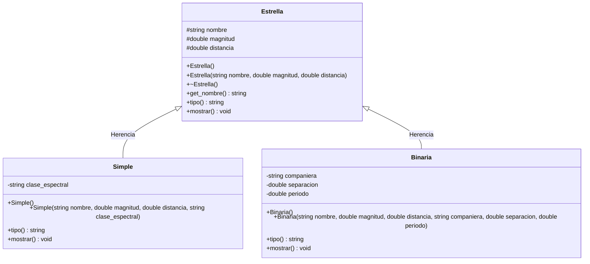
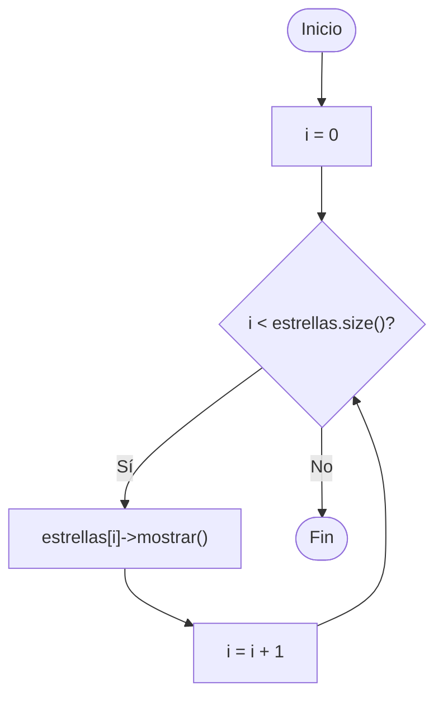

# A1 – Estrellas simples y binarias (sesión 12A)

> Ejemplo 1 de la sesión 12A: *la mayoría de las estrellas en el cielo están en pares. Genere una clase `Estrella` y clases derivadas `Simple` y `Binaria`. Utilice polimorfismo (métodos virtuales) para generar un vector de estrellas con 5 simples y 5 binarias y una función genérica para imprimir sus datos.*

Es el primer ejercicio de la unidad y el que fija la idea: **un solo bucle, un solo tipo de puntero, comportamientos distintos**.

## Diagrama de clase



## Dónde está el polimorfismo

El vector es `vector<Estrella*>`: **punteros a la superclase**. Dentro hay objetos `Simple` y objetos `Binaria`, pero el vector no lo sabe.

```cpp
void imprimir_estrellas(const vector<Estrella*>& estrellas) {
    for (size_t i = 0; i < estrellas.size(); i++) {
        estrellas[i]->mostrar();     // la subclase responde
    }
}
```

La función genérica **no tiene un solo `if`**. Quien decide qué código corre es la palabra `virtual` en `Estrella::mostrar()`, en tiempo de ejecución.

| | Sin `virtual` | Con `virtual` |
|---|---|---|
| Qué se decide en compilación | la función, por el tipo del puntero | solo la firma |
| Qué se decide en ejecución | nada | la versión, por el tipo real del objeto |
| Qué imprimen las 10 estrellas | 10 veces la versión de `Estrella` | 5 veces `Simple` y 5 veces `Binaria` |

Este es el **polimorfismo de inclusión** (o de herencia) del cuadro de clasificación: la rama *universal → inclusion*.

## Reusar en vez de duplicar

`Simple::mostrar()` y `Binaria::mostrar()` empiezan llamando a la versión de la superclase con el operador de resolución de ámbito:

```cpp
void Simple::mostrar() const {
    Estrella::mostrar();                                // nombre, magnitud, distancia
    cout << " | clase espectral: " << clase_espectral << endl;
}
```

Lo común se escribe una sola vez. Si mañana `Estrella` agrega un dato, las dos subclases lo imprimen sin tocarlas.

## Preguntas de la sesión

| Pregunta | Respuesta |
|---|---|
| ¿Por qué el vector es de punteros y no de objetos? | Un `vector<Estrella>` cortaría el objeto: guardaría solo la parte `Estrella` |
| ¿Por qué el destructor de `Estrella` es `virtual`? | Porque el `delete` se hace sobre un `Estrella*` y debe liberarse también la parte de la subclase |
| ¿Qué pasa si quito `virtual` de `mostrar()`? | Las diez líneas salen iguales: siempre la versión de `Estrella` |
| ¿`override` es obligatorio? | No, pero sin él un error de firma pasa desapercibido y se crea una función nueva |
| ¿Por qué `mostrar()` es `const`? | No modifica la estrella; y así el vector puede recibirse por referencia constante |
| ¿Hace falta un `if` por tipo en la función genérica? | No, y ese es justamente el punto del ejercicio |

## Diagrama de flujo – `imprimir_estrellas()`



## Ejecución

```
--- Catalogo de estrellas ---
1. Simple | Sol | magnitud: -26.74 | distancia: 1.58e-05 al | clase espectral: G2
...
6. Binaria | Sirio A | magnitud: -1.46 | distancia: 8.6 al | par: Sirio B | separacion: 20 ua | periodo: 50.1 anios
...

--- Total: 10 estrellas ---
```

## Tareas

- [ ] **1. Clase `Estrella`.** Atributos `protected` `nombre`, `magnitud` y `distancia`, con constructor vacío y con parámetros.
- [ ] **2. Destructor virtual.** `virtual ~Estrella();` — se va a liberar por puntero a la superclase.
- [ ] **3. `virtual string tipo()` y `virtual void mostrar()`.** La versión de la superclase imprime los tres datos comunes.
- [ ] **4. Clase `Simple`.** Hereda `public` y agrega `clase_espectral`. El constructor pasa los datos comunes a `Estrella(...)` en la lista de inicializadores.
- [ ] **5. Clase `Binaria`.** Hereda `public` y agrega `companiera`, `separacion` y `periodo`.
- [ ] **6. `override` de `tipo()` y `mostrar()`** en las dos subclases. *Pista: llama primero a `Estrella::mostrar()`.*
- [ ] **7. Función genérica.** `void imprimir_estrellas(const vector<Estrella*>&)`, fuera de las clases y **sin ningún `if` por tipo**.
- [ ] **8. `main`.** Crea el `vector<Estrella*>` y mete 5 `Simple` y 5 `Binaria` con `new`.
- [ ] **9. Liberación.** Recorre el vector haciendo `delete` de cada estrella.
- [ ] **10. Comprobación.** Quita el `virtual` de `mostrar()`, vuelve a ejecutar y explica qué cambió y por qué.
