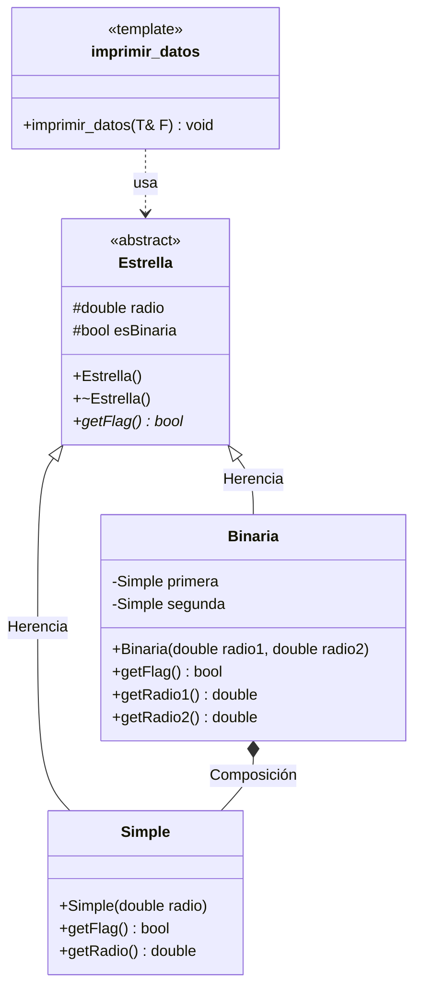
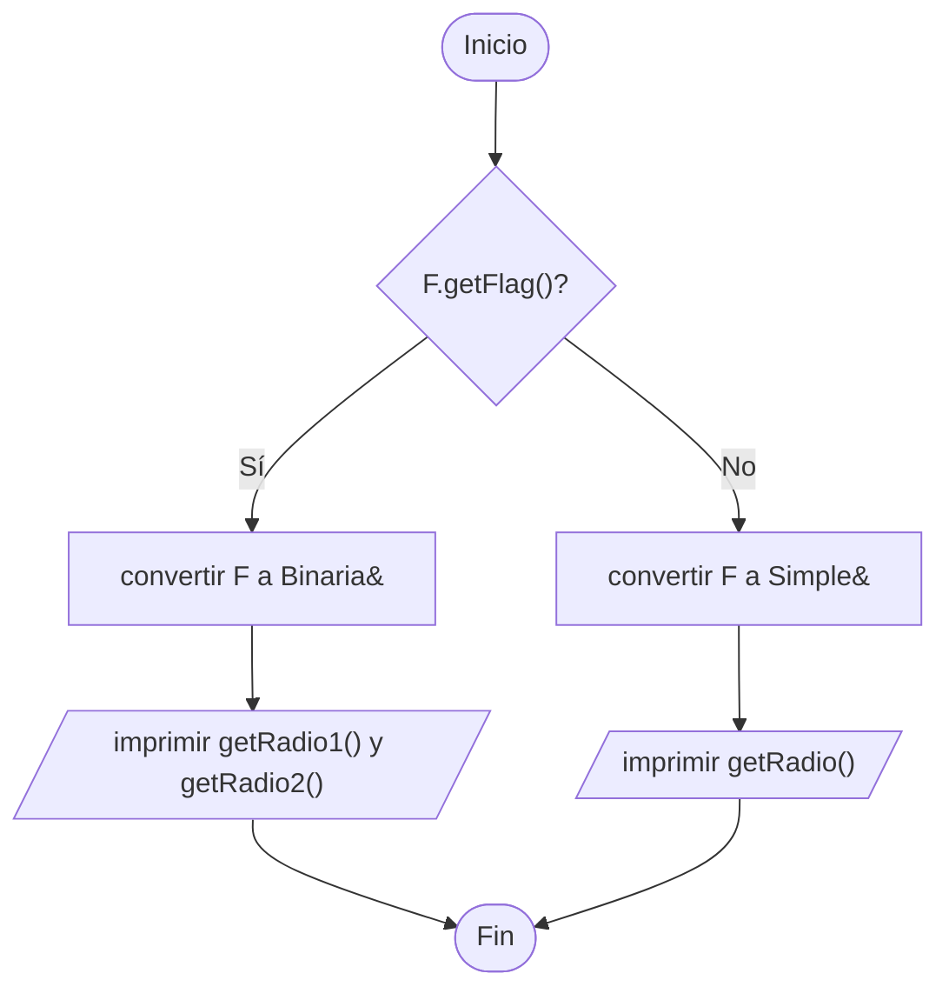

# A1 – Estrellas simples y binarias (sesión 12A)

> Ejemplo 1 de la sesión 12A: *la mayoría de las estrellas en el cielo están en pares. Genere una clase `Estrella` y clases derivadas `Simple` y `Binaria`. Utilice polimorfismo (métodos virtuales) para generar un vector de estrellas con 5 simples y 5 binarias y una función genérica para imprimir sus datos.*

## Diagrama de clase



## Las tres piezas

**`Estrella` es abstracta.** Su método `getFlag()` es **virtual puro** (`= 0`): no tiene cuerpo y cada subclase está obligada a implementarlo.

```cpp
virtual bool getFlag() = 0;
```

Por eso `Estrella e;` no compila: una estrella que no es ni simple ni binaria no existe.

**`Binaria` hereda y además contiene.** Es el ejercicio donde conviven las dos relaciones:

- *es una* estrella → `class Binaria : public Estrella`
- *tiene* dos estrellas simples → dos atributos `Simple`

```cpp
class Binaria : public Estrella {
private:
    Simple primera;
    Simple segunda;
};
```

Los dos `Simple` son **por valor**, no punteros: nacen y mueren con la binaria. Eso es composición.

**El flag dice qué hay dentro.** `esBinaria` es el dato que permite saber, desde un puntero a la base, cuántos radios tiene la estrella: uno o dos.

## La función genérica

El enunciado pide "una función genérica para imprimir sus datos", y se resuelve con una **plantilla**:

```cpp
template <typename T>
void imprimir_datos(T& F) {
    if (F.getFlag()) {
        Binaria& b = static_cast<Binaria&>(F);
        cout << "Binaria | radio 1: " << b.getRadio1() << " | radio 2: " << b.getRadio2();
    } else {
        Simple& s = static_cast<Simple&>(F);
        cout << "Simple  | radio: " << s.getRadio();
    }
}
```

`template <typename T>` escribe la función una sola vez con el tipo en blanco, y el compilador fabrica la versión que haga falta. Es **polimorfismo paramétrico**, otra de las cuatro ramas del cuadro de clasificación.

Dentro hace falta el `getFlag()` porque los radios **no están en la superclase**: `getRadio()` solo existe en `Simple` y `getRadio1()/getRadio2()` solo en `Binaria`. El flag indica a qué tipo convertir antes de pedirlos.

Las plantillas van **completas en el `.h`**, no se separan en `.h` y `.cpp` como las clases normales. Por eso `imprimir_datos.h` no tiene `.cpp`.

## El vector

```cpp
vector<Estrella*> cielo;
cielo.push_back(new Simple(1.0));
cielo.push_back(new Binaria(1.7, 0.9));
```

Punteros, no objetos. Dos razones:

1. `Estrella` es abstracta: un `vector<Estrella>` no compila, porque el vector necesitaría construir un `Estrella` para guardar cada copia.
2. Aunque fuera concreta, la copia **cortaría** el objeto y perdería la parte derivada.

## Preguntas de la sesión

| Pregunta | Respuesta |
|---|---|
| ¿Por qué `Estrella` no se puede instanciar? | Porque `getFlag()` es virtual pura: la definición está incompleta |
| ¿Por qué el vector es de punteros? | La clase es abstracta y además una copia cortaría el objeto |
| ¿Por qué `Binaria` guarda `Simple` por valor y no por puntero? | Las dos componentes nacen y mueren con ella: es composición |
| ¿Para qué sirve `esBinaria` si ya hay herencia? | Para saber, desde la base, cuántos radios pedir |
| ¿Por qué la plantilla va entera en el `.h`? | El compilador necesita el cuerpo para generar cada versión |
| ¿El destructor de `Estrella` por qué es virtual? | Porque el `delete` se hace sobre un `Estrella*` |

## Diagrama de flujo – `imprimir_datos(F)`



## Ejecución

```
--- Catalogo de estrellas ---
1. Simple  | radio: 1
2. Simple  | radio: 0.7
...
6. Binaria | radio 1: 1.7 | radio 2: 0.9
...

--- Total: 10 estrellas ---
```

## Tareas

- [ ] **1. Clase `Estrella`.** Atributos `protected` `radio` y `esBinaria`, con constructor vacío y con parámetros.
- [ ] **2. `virtual bool getFlag() = 0;`** Virtual **pura**: la clase queda abstracta. Comprueba que `Estrella e;` no compila.
- [ ] **3. Destructor virtual.** Se va a liberar por puntero a la superclase.
- [ ] **4. Clase `Simple`.** Hereda `public`, implementa `getFlag()` y agrega `getRadio()`. El constructor pasa el radio a `Estrella(...)` con el flag en `false`.
- [ ] **5. Clase `Binaria`.** Hereda `public` y **contiene dos objetos `Simple`** por valor.
- [ ] **6. `getRadio1()` y `getRadio2()`.** Devuelven el radio de cada componente. *Pista: pregúntaselo a cada `Simple`.*
- [ ] **7. Plantilla `imprimir_datos`.** En su propio `.h`, completa, sin `.cpp`.
- [ ] **8. El `if` del flag.** Usa `getFlag()` para decidir a qué tipo convertir antes de pedir los radios.
- [ ] **9. `main`.** Crea el `vector<Estrella*>` con 5 `Simple` y 5 `Binaria`, y recórrelo llamando a la plantilla.
- [ ] **10. Liberación.** `delete` de cada estrella.
- [ ] **11. Para pensar.** ¿Qué habría que cambiar para que la plantilla no necesitara el `if` ni las conversiones?
