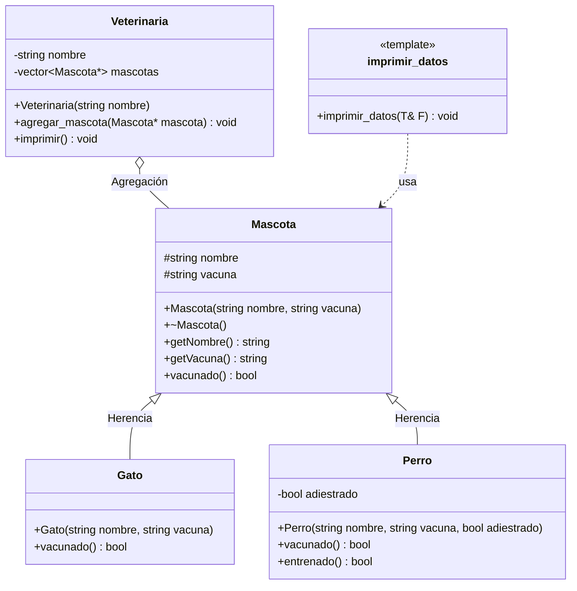
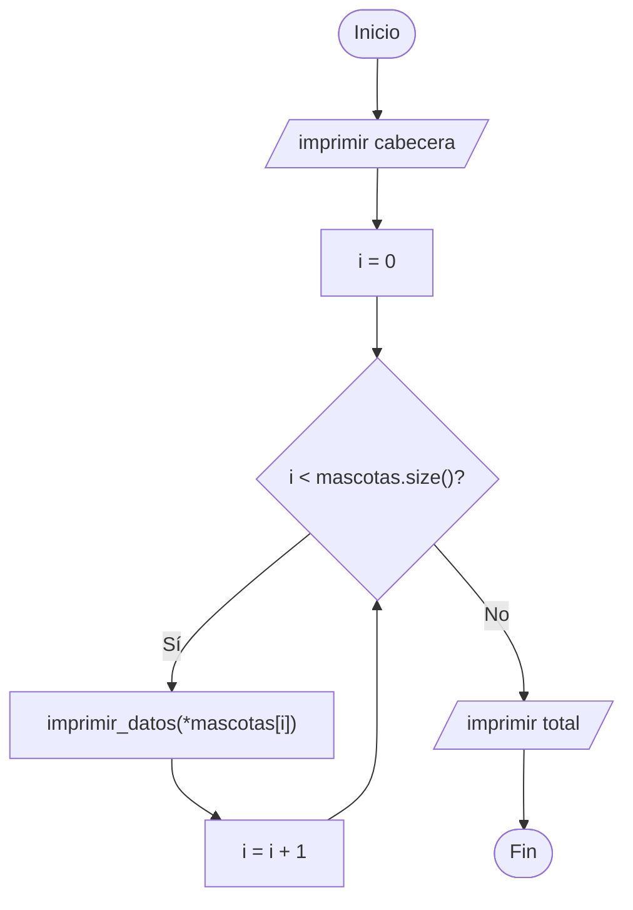

# A2 – Mascotas y Veterinaria (sesión 12A)

> Ejemplo 2 de la sesión 12A: *genere una clase `Mascota` y clases derivadas `Perro` y `Gato`. Cree un vector de perros y gatos y agréguelos a una clase `Veterinaria`. Imprima sus datos desde un método de clase (no externo).*

## Diagrama de clase



## Las dos relaciones del ejercicio

| Relación | Entre quiénes | Cómo se ve en el código |
|---|---|---|
| **Herencia** ("es un") | `Perro`/`Gato` → `Mascota` | `class Perro : public Mascota` |
| **Agregación** ("tiene") | `Veterinaria` → `Mascota` | `vector<Mascota*> mascotas` |

La agregación es con **punteros**, no por valor, y eso no es un detalle: por ahí entra el polimorfismo. Con `vector<Mascota>` cada elemento se guardaría cortado y `vacunado()` ejecutaría siempre la versión de la superclase.

## Por qué `vacunado()` es virtual

Cada especie tiene su vacuna obligatoria distinta, así que la misma pregunta da respuestas distintas:

| Clase | Qué cuenta como vacunado |
|---|---|
| `Mascota` | tener registrada cualquier vacuna |
| `Gato` | tener la **triple felina** |
| `Perro` | tener la **antirrábica** |

```cpp
bool Gato::vacunado() {
    return vacuna == "triple felina";
}
```

En la salida de prueba hay un perro, Lassie, con vacuna de gato: aparece como **NO vacunado** aunque tenga una vacuna registrada. Ese es el caso que demuestra que el `override` está entrando.

`Perro` agrega además `entrenado()`, un método que **no existe** en `Mascota` ni en `Gato`: solo se puede llamar sobre un `Perro`, no sobre un `Mascota*`.

## Imprimir desde un método de clase

El enunciado pide expresamente que la impresión no sea externa:

```cpp
void Veterinaria::imprimir() {
    for (size_t i = 0; i < mascotas.size(); i++) {
        imprimir_datos(*mascotas[i]);
    }
}
```

El vector es un **atributo privado** y nadie de afuera lo toca: la única forma de verlo es pidiéndoselo a la veterinaria. Dentro, `imprimir()` se apoya en la plantilla `imprimir_datos`, que sirve para cualquier tipo que sepa responder `getNombre()`, `getVacuna()` y `vacunado()`.

Las plantillas van **completas en el `.h`**: `imprimir_datos.h` no tiene `.cpp`.

## Preguntas de la sesión

| Pregunta | Respuesta |
|---|---|
| ¿Por qué `agregar_mascota()` recibe `Mascota*` y no `Perro*` o `Gato*`? | Para aceptar cualquier mascota presente o futura sin tocar la veterinaria |
| ¿Quién hace el `delete`? | El `main`, que hizo el `new`. La veterinaria solo conoce a sus pacientes |
| ¿Por qué Lassie sale NO vacunado si tiene vacuna? | Porque `Perro::vacunado()` exige la antirrábica, y tiene la felina |
| ¿Puedo llamar a `entrenado()` desde el vector? | No: el vector es de `Mascota*` y ese método solo existe en `Perro` |
| ¿Qué pasa si quito el `virtual` de `vacunado()`? | Todos se evalúan con la regla genérica de `Mascota` |
| ¿Se puede agregar `Loro` sin tocar `Veterinaria`? | Sí. Esa es la prueba de que el diseño está bien |

## Diagrama de flujo – `Veterinaria::imprimir()`



## Ejecución

```
=== Veterinaria Patitas Felices ===
1. Rocky | vacuna: antirrabica | vacunado
2. Michi | vacuna: triple felina | vacunado
3. Lassie | vacuna: triple felina | NO vacunado
4. Pelusa | vacuna: ninguna | NO vacunado
Total de mascotas: 4

--- Metodo propio del perro ---
Boby esta entrenado
```

## Tareas

- [ ] **1. Clase `Mascota`.** Atributos `protected` `nombre` y `vacuna`, un constructor con los dos y destructor **virtual**.
- [ ] **2. `getNombre()` y `getVacuna()`**, más `virtual bool vacunado()` con la regla genérica.
- [ ] **3. Clase `Gato`.** Hereda `public` y sobrescribe `vacunado()` con la triple felina.
- [ ] **4. Clase `Perro`.** Hereda `public`, sobrescribe `vacunado()` con la antirrábica y agrega `entrenado()`.
- [ ] **5. Plantilla `imprimir_datos`.** En su propio `.h`, completa, sin `.cpp`.
- [ ] **6. Clase `Veterinaria`.** Atributos privados `nombre` y `vector<Mascota*> mascotas`.
- [ ] **7. `agregar_mascota(Mascota*)`.** Guarda el puntero con `push_back`. *Pista: valida `nullptr`.*
- [ ] **8. `imprimir()`.** Recorre el vector llamando a la plantilla. **Sin `if` por tipo.**
- [ ] **9. `main`.** Crea las mascotas con `new`, agrégalas a la veterinaria y manda imprimir.
- [ ] **10. El caso de Lassie.** Dale a un perro una vacuna de gato y explica por qué sale como no vacunado.
- [ ] **11. `entrenado()`.** Llámalo sobre un `Perro` y luego intenta llamarlo desde el vector. ¿Qué dice el compilador?
- [ ] **12. Liberación.** `delete` de cada mascota en el `main`, no en la veterinaria.
