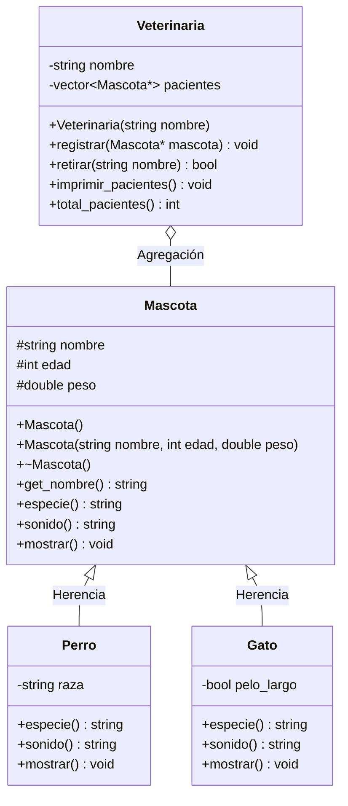
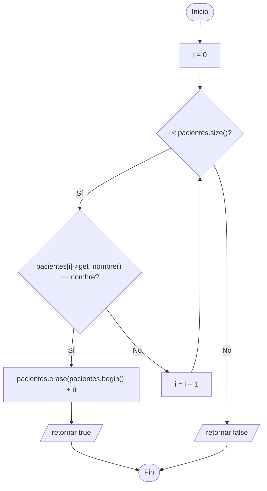

# A2 – Mascotas y Veterinaria (sesión 12A)

> Ejemplo 2 de la sesión 12A: *genere una clase `Mascota` y clases derivadas `Perro` y `Gato`. Cree un vector de perros y gatos y agréguelos a una clase `Veterinaria`. Imprima sus datos desde un método de clase (no externo).*

Mismo polimorfismo que A1, pero con un cambio de diseño importante: la impresión **ya no es una función suelta**, está dentro de la clase que administra la colección.

## Diagrama de clase



## Las dos relaciones del ejercicio

En este ejercicio conviven las dos cosas que se vieron en las últimas dos semanas:

| Relación | Entre quiénes | Cómo se ve en el código |
|---|---|---|
| **Herencia** ("es un") | `Perro`/`Gato` → `Mascota` | `class Perro : public Mascota` |
| **Agregación** ("tiene") | `Veterinaria` → `Mascota` | `vector<Mascota*> pacientes` |

La agregación es con **punteros**, no por valor, y eso no es un detalle: por ahí entra el polimorfismo.

| | `vector<Mascota>` | `vector<Mascota*>` |
|---|---|---|
| Qué guarda | copias cortadas | la dirección del objeto real |
| Qué imprime `mostrar()` | siempre la versión de `Mascota` | la del perro o la del gato |
| Quién libera | nadie (mueren con la veterinaria) | el `main`, que hizo el `new` |

## Imprimir desde un método de clase

El enunciado pide expresamente que la impresión **no** sea una función externa como en A1:

```cpp
void Veterinaria::imprimir_pacientes() const {
    for (size_t i = 0; i < pacientes.size(); i++) {
        pacientes[i]->mostrar();      // sigue siendo polimorfico
    }
}
```

La diferencia con A1 es de diseño, no de polimorfismo:

- en A1 el vector está en el `main` y una función libre lo recorre,
- aquí el vector es **un atributo privado** y nadie de afuera lo toca; la única forma de verlo es pidiéndoselo a la veterinaria.

Eso es encapsulamiento: la clase que tiene los datos es la que los muestra.

## Preguntas de la sesión

| Pregunta | Respuesta |
|---|---|
| ¿Por qué `registrar()` recibe `Mascota*` y no `Perro*` o `Gato*`? | Para aceptar cualquier mascota presente o futura sin tocar la veterinaria |
| ¿Quién hace el `delete`? | El `main`, que hizo el `new`. La veterinaria solo conoce a sus pacientes |
| ¿Qué pasaría si la veterinaria hiciera `delete` en su destructor? | Sería composición y el `main` no podría volver a usar esas mascotas |
| ¿Por qué `imprimir_pacientes()` es `const`? | No modifica la lista: solo la recorre |
| ¿`especie()` podría ser virtual pura? | Sí, si no quisiéramos que existan mascotas genéricas (ese caso se ve en A4) |
| ¿Se puede agregar `Loro` sin tocar `Veterinaria`? | Sí: se crea la subclase y se registra. Esa es la prueba de que el diseño está bien |

## Diagrama de flujo – `retirar(nombre)`



## Ejecución

```
=== Veterinaria Patitas Felices ===
1. Perro | Rocky | edad: 3 anios | peso: 18.5 kg | dice: Guau
    raza: Labrador
2. Gato | Michi | edad: 2 anios | peso: 4.2 kg | dice: Miau
    pelo: largo
...
Total de pacientes: 5

--- Retirando a Lassie ---
Lassie fue dada de alta
```

## Tareas

- [ ] **1. Clase `Mascota`.** Atributos `protected` `nombre`, `edad` y `peso`, constructores y destructor **virtual**.
- [ ] **2. `virtual especie()`, `virtual sonido()` y `virtual mostrar()`.** La versión de la superclase imprime los datos comunes.
- [ ] **3. Clase `Perro`.** Agrega `raza` y sobrescribe las tres con `override`.
- [ ] **4. Clase `Gato`.** Agrega `pelo_largo` y sobrescribe las tres con `override`.
- [ ] **5. Clase `Veterinaria`.** Atributos privados `nombre` y `vector<Mascota*> pacientes`.
- [ ] **6. `registrar(Mascota*)`.** Guarda el puntero con `push_back`. *Pista: valida `nullptr`.*
- [ ] **7. `imprimir_pacientes()`.** Recorre el vector con `->` y llama a `mostrar()`. **Sin `if` por tipo.**
- [ ] **8. `retirar(string)`.** Busca por nombre, usa `erase` y devuelve `bool`.
- [ ] **9. `main`.** Crea las mascotas con `new`, regístralas, imprime, retira una y vuelve a imprimir.
- [ ] **10. Liberación.** Haz `delete` de cada mascota en el `main`, no en la veterinaria.
- [ ] **11. Para pensar.** Cambia el atributo a `vector<Mascota>` por valor y explica qué pasa con la salida.
