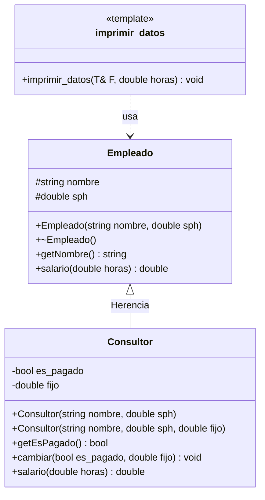
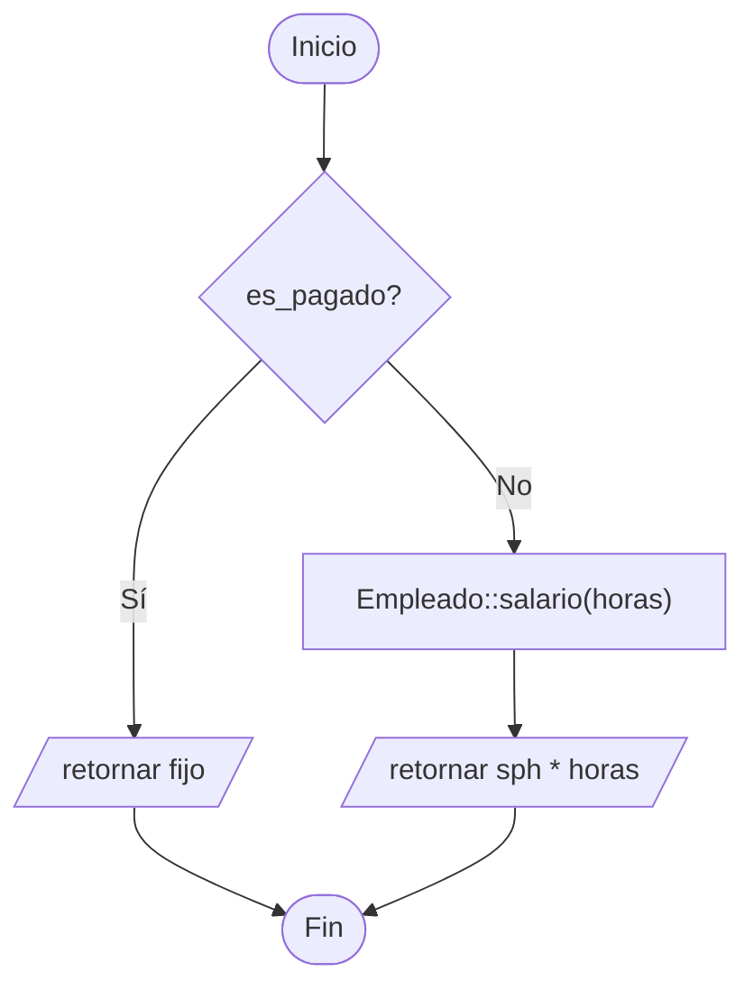

# A3 – Empleado y Consultor (sesión 12A)

> Ejemplo 3 de la sesión 12A: *genere una clase `Empleado` y una clase `Consultor` que derive de `Empleado`. Calcule el salario del empleado si tiene el salario por hora. El consultor puede o no tener salario fijo; calcule su salario en caso lo tenga. Imprima la lista de consultores y empleados.*

## Diagrama de clase



`sph` es el **salario por hora**, y `es_pagado` indica si el consultor tiene salario fijo pactado.

## Las dos reglas de sueldo

| | Empleado | Consultor sin salario fijo | Consultor con salario fijo |
|---|---|---|---|
| Fórmula | `sph * horas` | `sph * horas` | el monto `fijo` |
| Quién la implementa | `Empleado::salario()` | la hereda del padre | `Consultor::salario()` |

```cpp
double Consultor::salario(double horas) {
    if (es_pagado) {
        return fijo;
    }
    return Empleado::salario(horas);   // no se duplica la formula del padre
}
```

Ese `Empleado::salario(horas)` es el **operador de resolución de ámbito**. Sin él habría que volver a escribir `sph * horas` dentro del consultor, y el día que cambie la fórmula habría que corregirla en dos sitios.

## El "puede o no tener" del enunciado

Hay dos constructores, y el que uses decide la regla de pago:

```cpp
Consultor marta("Marta Rios", 60.00);                 // sin fijo: cobra por hora
Consultor jorge("Jorge Leon", 55.00, 4500.00);        // con fijo
```

Eso ya es **sobrecarga de funciones** aplicada a constructores: el compilador elige por la lista de parámetros, dos argumentos o tres. Es el polimorfismo *ad-hoc* que se ve a fondo en la sesión 12B.

Y `cambiar()` permite moverlo después de creado:

```cpp
marta.cambiar(true, 7000.00);   // ahora si tiene salario fijo
```

## La función genérica

```cpp
template <typename T>
void imprimir_datos(T& F, double horas) {
    cout << F.getNombre() << horas << F.salario(horas);
}
```

Una sola plantilla imprime la fila de cualquier trabajador, sea empleado o consultor. Dentro no hay ningún `if` por tipo: `salario()` es virtual y cada objeto responde con su propia fórmula.

Las plantillas van **completas en el `.h`**: `imprimir_datos.h` no tiene `.cpp`.

## Preguntas de la sesión

| Pregunta | Respuesta |
|---|---|
| ¿Por qué el vector es `vector<Empleado*>`? | Para tener empleados y consultores mezclados en una sola planilla |
| ¿Cómo sabe la plantilla qué fórmula usar? | No lo sabe: `salario()` es virtual y cada objeto responde la suya |
| ¿Por qué `Consultor` llama a `Empleado::salario()`? | Para no repetir la fórmula por hora que ya está en el padre |
| ¿Qué pasa si olvido `virtual` en `salario()`? | Todos cobran con la fórmula del padre, y el consultor con fijo cobra de más |
| ¿Dos constructores son polimorfismo? | Sí, sobrecarga: misma función, distinta lista de parámetros |
| ¿Para qué sirve `cambiar()`? | Para pasar un consultor de pago por hora a salario fijo sin recrearlo |

## Diagrama de flujo – `Consultor::salario(horas)`



## Ejecución

```
NOMBRE               HORAS     SALARIO
--------------------------------------
Ana Quispe        160.00 h     4000.00
Luis Torres       160.00 h     2960.00
Marta Rios        160.00 h     9600.00
Jorge Leon        160.00 h     4500.00

--- Marta pasa a tener salario fijo ---
Marta Rios        160.00 h     7000.00
```

Fíjate en Marta: aunque es consultora, su salario sale de la fórmula del padre porque no tiene fijo. Tras `cambiar()`, cobra el monto pactado.

## Tareas

- [ ] **1. Clase `Empleado`.** Atributos `protected` `nombre` y `sph`, un constructor con los dos y destructor **virtual**.
- [ ] **2. `virtual double salario(double horas)`.** Devuelve `sph * horas`.
- [ ] **3. `getNombre()`**, para que la plantilla pueda imprimirlo.
- [ ] **4. Clase `Consultor`.** Hereda `public` y agrega `es_pagado` y `fijo`.
- [ ] **5. Dos constructores.** Uno sin salario fijo (deja el flag en `false`) y otro con salario fijo.
- [ ] **6. `salario()` con `override`.** Si tiene fijo devuelve el fijo; si no, **llama a `Empleado::salario(horas)`**.
- [ ] **7. `cambiar(bool, double)`.** Cambia la condición de pago de un consultor ya creado.
- [ ] **8. Plantilla `imprimir_datos`.** En su propio `.h`, recibe el trabajador y las horas.
- [ ] **9. `main`.** Crea un `vector<Empleado*>` con empleados y consultores de los dos tipos, y recórrelo.
- [ ] **10. Prueba `cambiar()`.** Convierte un consultor por horas en uno con salario fijo y vuelve a imprimirlo.
- [ ] **11. Comprobación.** Quita el `virtual` de `salario()` y explica por qué cambia el sueldo de Jorge.
