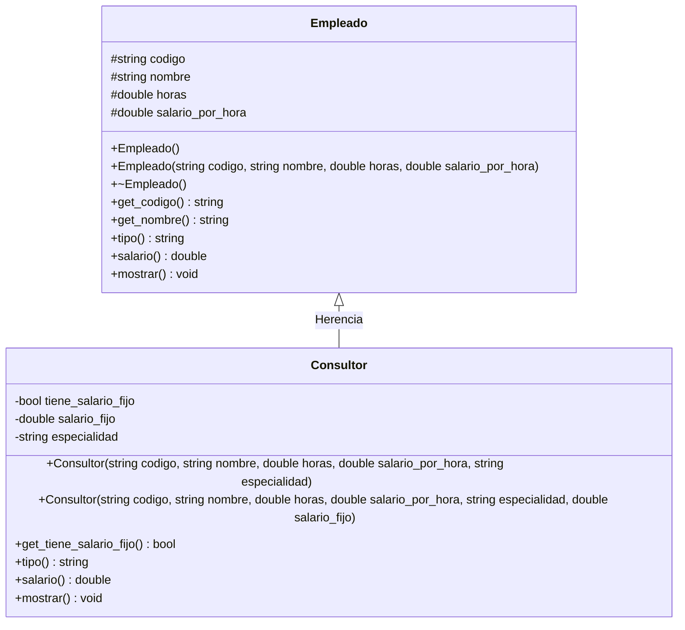
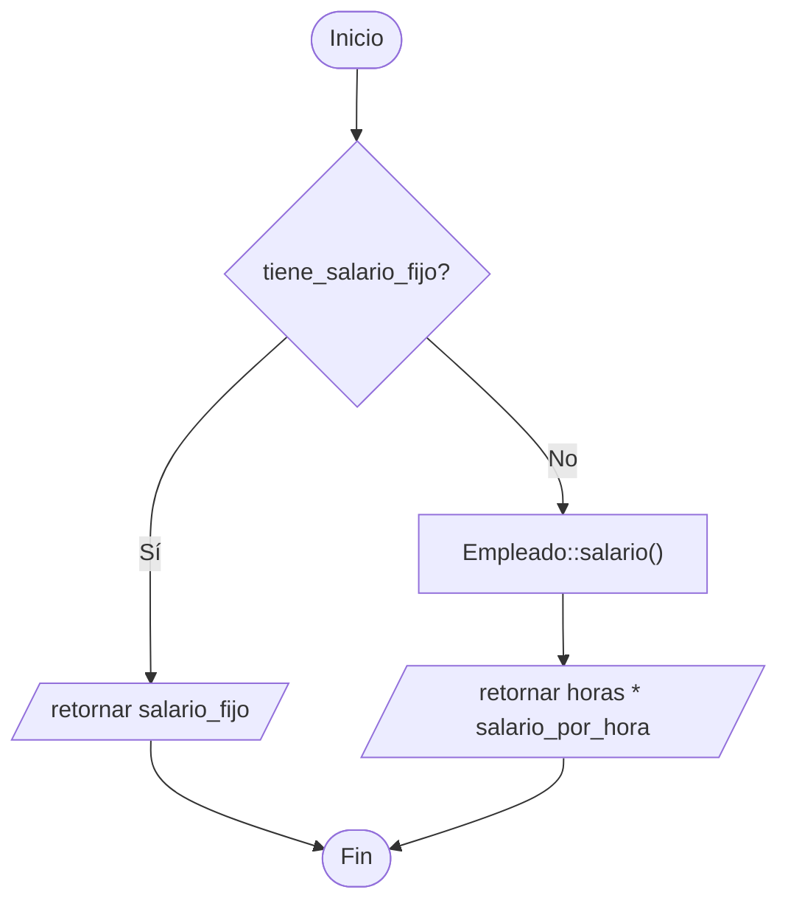

# A3 – Empleado y Consultor (sesión 12A)

> Ejemplo 3 de la sesión 12A: *genere una clase `Empleado` y una clase `Consultor` que derive de `Empleado`. Calcule el salario del empleado si tiene el salario por hora. El consultor puede o no tener salario fijo; calcule su salario en caso lo tenga. Imprima la lista de consultores y empleados.*

El ejercicio agrega una vuelta de tuerca a lo de A1 y A2: la subclase no solo sobrescribe el método, también **reutiliza la versión del padre** cuando le conviene.

## Diagrama de clase



## Las dos reglas de sueldo

| | Empleado | Consultor sin salario fijo | Consultor con salario fijo |
|---|---|---|---|
| Fórmula | `horas * salario_por_hora` | `horas * salario_por_hora` | `salario_fijo` |
| Quién la implementa | `Empleado::salario()` | la hereda del padre | `Consultor::salario()` |

```cpp
double Consultor::salario() const {
    if (tiene_salario_fijo) {
        return salario_fijo;
    }
    return Empleado::salario();   // no se duplica la formula del padre
}
```

Ese `Empleado::salario()` es el **operador de resolución de ámbito**. Sin él, escribir otra vez `horas * salario_por_hora` dentro del consultor sería duplicar una regla que ya existe: el día que cambie la fórmula habría que corregirla en dos sitios.

## El "puede o no tener" del enunciado

El consultor tiene dos constructores, y el que se use decide la regla de pago. Esto ya es **sobrecarga de funciones** — el polimorfismo *ad-hoc* que se ve a fondo en la sesión 12B — aplicada a constructores:

```cpp
Consultor marta("C001", "Marta Rios", 40, 60.00, "Base de datos");              // sin fijo
Consultor jorge("C002", "Jorge Leon", 30, 55.00, "Redes", 4500.00);             // con fijo
```

El compilador elige por la **lista de parámetros**: cinco argumentos o seis.

## Preguntas de la sesión

| Pregunta | Respuesta |
|---|---|
| ¿Por qué el vector es `vector<Empleado*>`? | Para que la planilla tenga empleados y consultores mezclados en una sola lista |
| ¿Cómo sabe el bucle qué fórmula usar? | No lo sabe: `salario()` es virtual y cada objeto responde la suya |
| ¿Por qué `Consultor` llama a `Empleado::salario()`? | Para no repetir la fórmula por hora que ya está escrita en el padre |
| ¿Qué pasa si olvido `virtual` en `salario()`? | El total de planilla se calcula con la fórmula del padre para todos |
| ¿Dos constructores son polimorfismo? | Sí, sobrecarga: misma función, distinta lista de parámetros |
| ¿Se podría usar un solo constructor? | Sí, con un parámetro por defecto, pero se pierde la lectura de "este no tiene fijo" |

## Diagrama de flujo – `Consultor::salario()`



## Ejecución

```
TIPO      CODIGO  NOMBRE                   HORAS       TARIFA     SALARIO
-------------------------------------------------------------------------
Empleado  E001    Ana Quispe            160.00 h     25.00 /h     4000.00
Empleado  E002    Luis Torres           180.00 h     18.50 /h     3330.00
Consultor C001    Marta Rios             40.00 h     60.00 /h     2400.00
          especialidad: Base de datos | salario fijo: no
Consultor C002    Jorge Leon             30.00 h     55.00 /h     4500.00
          especialidad: Redes | salario fijo: si
Consultor C003    Rosa Diaz              50.00 h     48.00 /h     6000.00
          especialidad: Seguridad | salario fijo: si
-------------------------------------------------------------------------
Total de la planilla: 20230.00
```

Fíjese en Marta: aunque es consultora, su salario sale de la fórmula del padre porque no tiene fijo.

## Tareas

- [ ] **1. Clase `Empleado`.** Atributos `protected` `codigo`, `nombre`, `horas` y `salario_por_hora`.
- [ ] **2. Destructor virtual** y getters `const`.
- [ ] **3. `virtual double salario() const`.** Devuelve `horas * salario_por_hora`.
- [ ] **4. `virtual void mostrar() const`.** Imprime una fila de la planilla. *Pista: usa `<iomanip>` con `setw` y `setprecision(2)`.*
- [ ] **5. Clase `Consultor`.** Hereda `public` y agrega `tiene_salario_fijo`, `salario_fijo` y `especialidad`.
- [ ] **6. Dos constructores.** Uno sin salario fijo (pone el flag en `false`) y otro con salario fijo.
- [ ] **7. `salario()` con `override`.** Si tiene fijo devuelve el fijo; si no, **llama a `Empleado::salario()`**.
- [ ] **8. `mostrar()` con `override`.** Llama a `Empleado::mostrar()` y agrega la línea de especialidad.
- [ ] **9. `main`.** Crea un `vector<Empleado*>` con empleados y consultores de los dos tipos.
- [ ] **10. Total de planilla.** En el mismo bucle acumula `salario()` y muestra el total. Libera con `delete`.
- [ ] **11. Comprobación.** Quita el `virtual` de `salario()` y explica por qué el total cambia.
