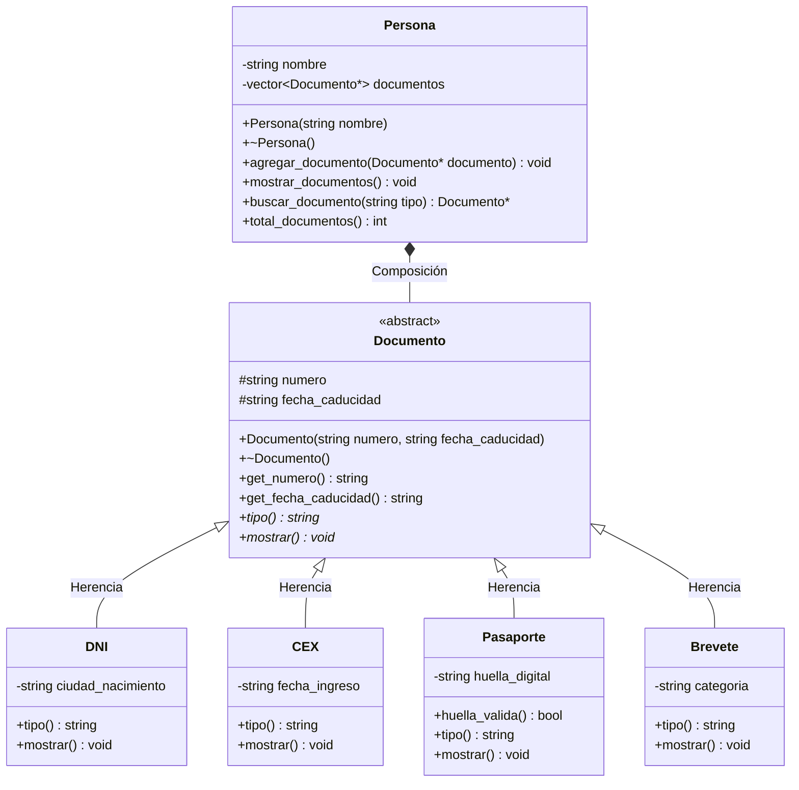
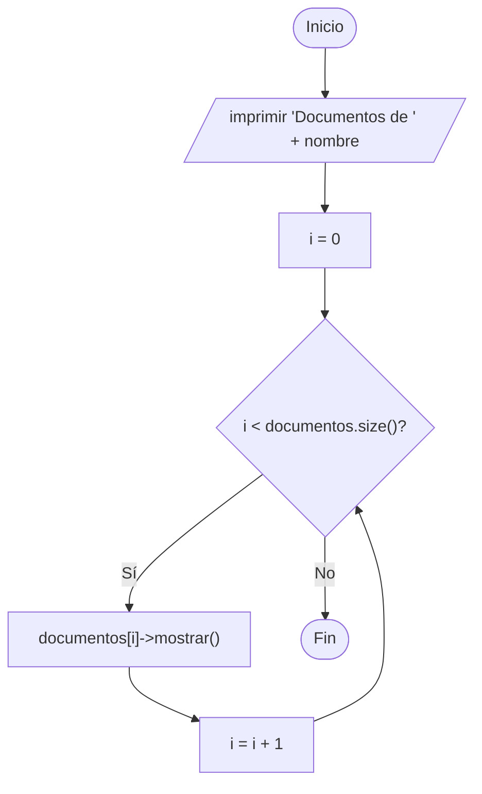

# A4 – Documentos de una persona (sesión 12A)

> Ejemplo 4 de la sesión 12A: *genere una clase `Documento` con clases derivadas `DNI`, `CEX`, `Pasaporte` y `Brevete`. Todos los documentos tendrán un número y fecha de caducidad. Además, el `DNI` tendrá una ciudad de nacimiento, el `CEX` una fecha de ingreso al país, el `brevete` una categoría y el `Pasaporte` una huella digital, representada por una cadena binaria. Genere una clase `Persona` que contenga un vector de documentos (**¿qué relación se necesita construir?**), así como un método para mostrar los documentos de la persona.*

Es el ejercicio más completo de la sesión: junta **clase abstracta**, **polimorfismo** y la pregunta de relación que arrastramos desde la semana 11.

## Diagrama de clase



## La pregunta del enunciado: ¿qué relación se necesita?

La diapositiva pregunta explícitamente qué relación hay entre `Persona` y `Documento`. Hay que decidir **dos cosas distintas**:

**1. Punteros o valores.** Punteros, obligatoriamente. Un `vector<Documento>` ni siquiera compila: `Documento` es abstracta y el vector necesitaría construir uno para guardar la copia. Y aunque fuera concreta, la copia cortaría el objeto y perderíamos la ciudad, la huella o la categoría.

**2. Agregación o composición.** Un documento pertenece a **una** persona y no se comparte ni sobrevive sin ella. Es **composición**, y por eso el destructor de `Persona` hace el `delete`:

```cpp
Persona::~Persona() {
    for (size_t i = 0; i < documentos.size(); i++) {
        delete documentos[i];
    }
}
```

| | A2 (Veterinaria) | A4 (Persona) |
|---|---|---|
| Atributo | `vector<Mascota*>` | `vector<Documento*>` |
| ¿Quién hace `new`? | el `main` | el `main` (y se lo entrega) |
| ¿Quién hace `delete`? | el `main` | **la propia `Persona`** |
| La parte sobrevive al todo | sí | no |
| Relación | agregación ◇ | **composición ◆** |

Las dos usan punteros y las dos tienen polimorfismo: lo que cambia es **quién es el dueño**.

## Por qué `Documento` es abstracta

`tipo()` y `mostrar()` son **funciones virtuales puras** (`= 0`):

```cpp
virtual std::string tipo() const = 0;
virtual void mostrar() const = 0;
```

No hay forma razonable de "mostrar un documento genérico": cada tipo imprime un dato distinto. Al declararlas puras:

- `Documento documento;` **no compila** (clase abstracta, definición incompleta),
- toda subclase está **obligada** a implementar las dos,
- el que olvide una se entera en compilación, no en la demo.

Los atributos comunes (`numero`, `fecha_caducidad`) sí viven en la superclase: abstracta no significa vacía.

## El dato binario del pasaporte

La huella es "una cadena binaria", así que `Pasaporte` agrega una validación propia que las demás clases no tienen:

```cpp
bool Pasaporte::huella_valida() const;   // solo '0' y '1'
```

En la salida de prueba, la huella de Lucía (`10102X0111`) sale marcada como inválida a propósito.

## Preguntas de la sesión

| Pregunta | Respuesta |
|---|---|
| ¿Por qué no `vector<Documento>`? | `Documento` es abstracta: el vector no puede construir sus elementos |
| ¿Qué error da si intento instanciar `Documento`? | `cannot declare variable to be of abstract type` |
| ¿Por qué el destructor de `Documento` es virtual? | Porque `Persona` libera a través de un `Documento*` |
| ¿Dónde está el `delete` y por qué ahí? | En `~Persona()`: la persona es la dueña de sus documentos |
| ¿Por qué `buscar_documento()` devuelve puntero y no objeto? | Para poder devolver `nullptr` cuando no existe, y para no cortar el objeto |
| ¿Cómo agrego un `CarnetUniversitario`? | Una subclase más; `Persona` no se toca |

## Diagrama de flujo – `mostrar_documentos()`



## Ejecución

```
Documentos de Carlos Palomino:
  [DNI] numero: 45781236 | caduca: 12/08/2030 | ciudad de nacimiento: Callao
  [Pasaporte] numero: P1234567 | caduca: 05/03/2032 | huella: 1011001110 (valida)
  [Brevete] numero: Q45781236 | caduca: 20/11/2028 | categoria: A-IIb

Documentos de Lucia Fernandes:
  [CEX] numero: 001234567 | caduca: 30/06/2029 | ingreso al pais: 15/02/2021
  [Pasaporte] numero: BR998877 | caduca: 14/09/2031 | huella: 10102X0111 (invalida)

--- Buscando el brevete de Carlos ---
  caduca el 20/11/2028

--- Buscando el DNI de Lucia ---
  Lucia no tiene DNI: es extranjera
```

En el `main` **no hay un solo `delete`**: cada persona libera lo suyo.

## Tareas

- [ ] **1. Clase `Documento`.** Atributos `protected` `numero` y `fecha_caducidad`, constructores y destructor **virtual**.
- [ ] **2. Funciones virtuales puras.** `tipo()` y `mostrar()` con `= 0`. Comprueba que `Documento d;` no compila.
- [ ] **3. Clase `DNI`.** Agrega `ciudad_nacimiento` e implementa las dos funciones puras.
- [ ] **4. Clase `CEX`.** Agrega `fecha_ingreso` al país.
- [ ] **5. Clase `Brevete`.** Agrega `categoria`.
- [ ] **6. Clase `Pasaporte`.** Agrega `huella_digital` y el método propio `huella_valida()`. *Pista: recorre el string y acepta solo `'0'` y `'1'`.*
- [ ] **7. Clase `Persona`.** Atributos privados `nombre` y `vector<Documento*> documentos`.
- [ ] **8. `agregar_documento(Documento*)`** y **`mostrar_documentos()`**, este último sin ningún `if` por tipo.
- [ ] **9. Destructor de `Persona`.** Recorre el vector haciendo `delete`: la relación es composición.
- [ ] **10. `buscar_documento(string tipo)`.** Devuelve el puntero o `nullptr`.
- [ ] **11. `main`.** Crea dos personas con documentos distintos y muestra los dos juegos.
- [ ] **12. Responde el enunciado.** ¿Qué relación se necesita y por qué no puede ser `vector<Documento>`?
