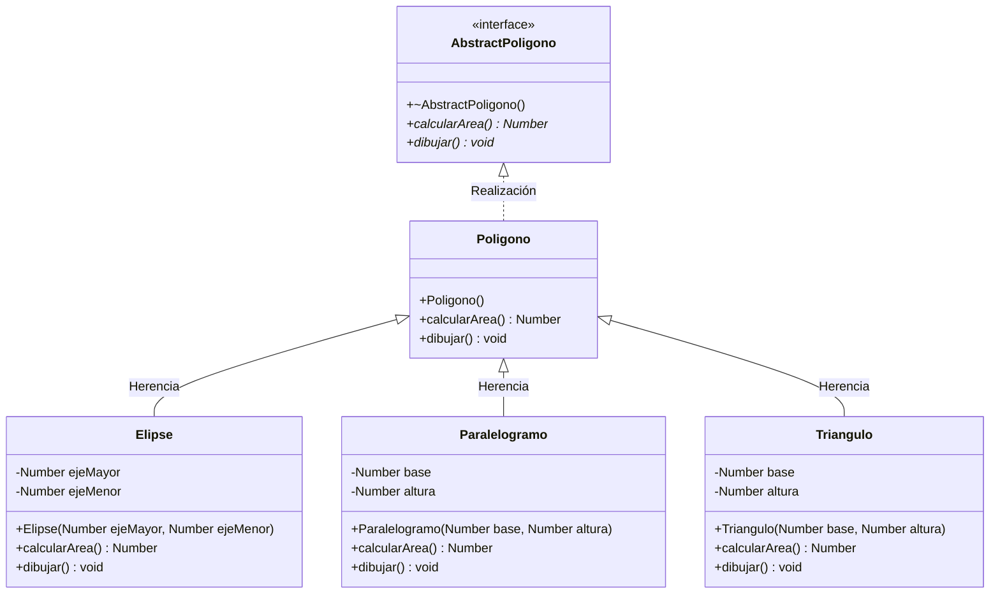
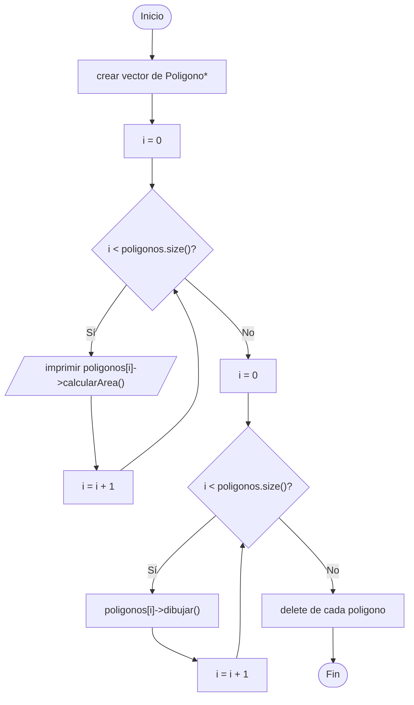

# A5 – Figuras geométricas (sesión 12A)

> Ejemplo 5 de la sesión 12A: *desarrolle un programa que dibuje una serie de figuras geométricas respetando la jerarquía que aparece a continuación.*

El código de `AbstractPoligono`, `Poligono`, `Elipse`, `Triangulo` y el `main` **está en las diapositivas 11 a 14**. Esta carpeta lo arma completo, agrega el `Paralelogramo` que falta en el diagrama y deja apuntadas las cosas que no cierran del todo.

## Diagrama de clase

El de la diapositiva 10, en notación UML:



La caja de arriba va **punteada** en el diagrama de la diapositiva: es una interfaz, una clase sin nada implementado.

## Los tres niveles

| Clase | Qué es | Se puede instanciar |
|---|---|---|
| `AbstractPoligono` | interfaz: dos funciones virtuales **puras** | no |
| `Poligono` | implementa las dos sin contenido útil (área 0, dibujo vacío) | sí |
| `Elipse`, `Paralelogramo`, `Triangulo` | figuras reales, cada una con su fórmula | sí |

`Poligono` existe para ser **el tipo común del vector**:

```cpp
vector<Poligono*> poligonos = {new Triangulo(10, 10), new Elipse(10, 10)};
```

El vector es de `Poligono*` y adentro hay triángulos y elipses. Un solo bucle recorre todo, y `virtual` decide qué `calcularArea()` corre en cada vuelta: **polimorfismo de inclusión**, la rama *universal → inclusion* del cuadro de clasificación.

## `tipos.h` y el tipo `Number`

La diapositiva declara `tipos.h` así:

```cpp
using entero = int;
using real = float;
using caracter = char;
```

…pero las figuras usan `Number` en todas sus firmas. Para que el código de la diapositiva compile tal cual, el `tipos.h` de esta carpeta agrega la línea que falta:

```cpp
using Number = real;
```

Un `using` es solo **otro nombre** para un tipo que ya existe; no crea un tipo nuevo.

## Para pensar: tres cosas que no cierran

El código está tal como aparece en la diapositiva. Hay tres detalles para discutir en clase antes de corregirlos:

**1. El área del triángulo.**

```cpp
Number Triangulo::calcularArea() {
    return base * altura;        // falta dividir entre 2
}
```

Con base 10 y altura 10 el programa imprime 100, y el triángulo mide 50.

**2. El área de la elipse.** La fórmula correcta es `PI * a * b` con los **semiejes**. Si los atributos son los ejes completos, el área sale 4 veces más grande.

**3. El tipo del índice.**

```cpp
for (auto i = 0; i < poligonos.size(); i++)
```

`auto i = 0` deduce `int`, y `size()` devuelve `size_t` (sin signo). El compilador avisa con `-Wall`: *comparison of integer expressions of different signedness*. Se arregla con `size_t i = 0`.

Los tres compilan y corren; ninguno es un error de polimorfismo, y por eso son buenos para mostrar que "compila" no es lo mismo que "está bien".

## Preguntas de la sesión

| Pregunta | Respuesta |
|---|---|
| ¿Para qué sirve `AbstractPoligono` si `Poligono` no hace nada? | Separa el contrato (qué sabe hacer una figura) de la jerarquía concreta |
| ¿Por qué el vector no es de `AbstractPoligono*`? | Podría serlo; la diapositiva usa `Poligono*` como tipo común |
| ¿Por qué el destructor de la interfaz es virtual? | Porque el `delete` se hace sobre un puntero al tipo base |
| ¿`calcularArea()` podría ser `const`? | Sí, y debería: no modifica la figura. En la diapositiva solo `dibujar()` lo es |
| ¿Qué pasa si una subclase no implementa `dibujar()`? | Hereda la versión vacía de `Poligono`; si heredara de la interfaz, no compilaría |
| ¿Qué hay que tocar para agregar un `Circulo`? | Solo la clase nueva y una línea en el `main` |

## Diagrama de flujo – programa principal



## Ejecución

```
Area
Area es: 100
Area es: 314.16
Area es: 376.992
Area es: 40

Dibujar
dibujar triangulo
draw elipse
draw elipse
dibujar paralelogramo
```

## Tareas

- [ ] **1. `tipos.h`.** Los tres `using` de la diapositiva más `using Number = real;`.
- [ ] **2. `AbstractPoligono.h`.** Destructor virtual y las dos funciones **virtuales puras**. Es solo un `.h`, no lleva `.cpp`.
- [ ] **3. `Poligono`.** Hereda de la interfaz e implementa las dos con `override`: área 0 y dibujo vacío.
- [ ] **4. `Elipse`.** Atributos `ejeMayor` y `ejeMenor`, constructor y las dos funciones. *Pista: `const double PI = 3.1416;` en el `.cpp`.*
- [ ] **5. `Triangulo`.** Atributos `base` y `altura`, constructor y las dos funciones.
- [ ] **6. `Paralelogramo`.** Está en el diagrama pero no en el código de la diapositiva: hay que escribirlo.
- [ ] **7. `main`.** Crea el `vector<Poligono*>` con la lista de inicialización y agrega más figuras con `push_back`.
- [ ] **8. Dos bucles.** Uno que imprime las áreas y otro que dibuja; ninguno con `if` por tipo.
- [ ] **9. Liberación.** `delete` de cada figura y `clear()` del vector.
- [ ] **10. Corrige el triángulo.** Divide entre 2 y verifica que el área pase de 100 a 50.
- [ ] **11. Corrige el índice.** Cambia `auto i = 0` por `size_t i = 0` y comprueba que desaparece el warning de `-Wall`.
- [ ] **12. Para pensar.** Si `Poligono` desapareciera y las figuras heredaran directo de `AbstractPoligono`, ¿qué habría que cambiar?
