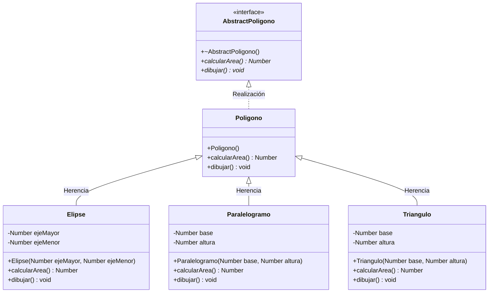

# A5 – Figuras geométricas (sesión 12A)

> Ejemplo 5 de la sesión 12A: *desarrolle un programa que dibuje una serie de figuras geométricas respetando la jerarquía que aparece a continuación.*

Tres niveles de jerarquía: una interfaz arriba, una clase intermedia en medio y las figuras concretas abajo, cada una con su propia fórmula de área.

## Diagrama de clase

La jerarquía completa en notación UML:



La caja de arriba va **punteada**: es una interfaz, una clase sin nada implementado.

## Los tres niveles

| Clase | Qué es | Se puede instanciar |
|---|---|---|
| `AbstractPoligono` | interfaz: dos funciones virtuales **puras** | no |
| `Poligono` | implementa las dos sin contenido útil (área 0, dibujo vacío) | sí |
| `Elipse`, `Paralelogramo`, `Triangulo` | figuras reales, cada una con su fórmula | sí |

`Poligono` existe para ser **el tipo común del vector**:

```cpp
vector<Poligono*> poligonos = {new Triangulo(10, 10), new Elipse(10, 10)};
```

El vector es de `Poligono*` y adentro hay triángulos y elipses. Un solo bucle recorre todo, y `virtual` decide qué `calcularArea()` corre en cada vuelta: **polimorfismo de inclusión**, la rama *universal → inclusion* del cuadro de clasificación.

## `tipos.h` y el tipo `Number`

Las figuras usan `Number` en todas sus firmas, y `Number` no es un tipo del lenguaje: es un nombre definido en `tipos.h`.

```cpp
using entero = int;
using real = float;
using caracter = char;

using Number = real;
```

Un `using` es solo **otro nombre** para un tipo que ya existe; no crea un tipo nuevo. La ventaja: si mañana las figuras necesitan `double` en vez de `float`, se cambia una línea y no las ocho firmas.

## Preguntas de la sesión

| Pregunta | Respuesta |
|---|---|
| ¿Para qué sirve `AbstractPoligono` si `Poligono` no hace nada? | Separa el contrato (qué sabe hacer una figura) de la jerarquía concreta |
| ¿Por qué el vector es de `Poligono*`? | Es el tipo común de todas las figuras; también funcionaría con `AbstractPoligono*` |
| ¿Por qué el destructor de la interfaz es virtual? | Porque el `delete` se hace sobre un puntero al tipo base |
| ¿Por qué `dibujar()` es `const` y `calcularArea()` no? | Ninguna de las dos modifica la figura: `calcularArea()` también podría serlo |
| ¿Qué pasa si una subclase no implementa `dibujar()`? | Hereda la versión vacía de `Poligono`; si heredara de la interfaz, no compilaría |
| ¿Qué hay que tocar para agregar un `Circulo`? | Solo la clase nueva y una línea en el `main` |

## Diagrama de flujo – programa principal


## Ejecución

```
Area
Area es: 50
Area es: 78.54
Area es: 94.248
Area es: 40

Dibujar
dibujar triangulo
draw elipse
draw elipse
dibujar paralelogramo
```

## Tareas

- [ ] **1. `tipos.h`.** Los `using` de `entero`, `real` y `caracter`, más `using Number = real;`.
- [ ] **2. `AbstractPoligono.h`.** Destructor virtual y las dos funciones **virtuales puras**. Es solo un `.h`, no lleva `.cpp`.
- [ ] **3. `Poligono`.** Hereda de la interfaz e implementa las dos con `override`: área 0 y dibujo vacío.
- [ ] **4. `Elipse`.** Atributos `ejeMayor` y `ejeMenor`, constructor y las dos funciones. *Pista: `const double PI = 3.1416;` en el `.cpp`, y el área usa los semiejes.*
- [ ] **5. `Triangulo`.** Atributos `base` y `altura`, constructor y las dos funciones.
- [ ] **6. `Paralelogramo`.** La tercera figura del diagrama, con `base` y `altura`.
- [ ] **7. `main`.** Crea el `vector<Poligono*>` con la lista de inicialización y agrega más figuras con `push_back`.
- [ ] **8. Dos bucles.** Uno que imprime las áreas y otro que dibuja; ninguno con `if` por tipo.
- [ ] **9. Liberación.** `delete` de cada figura y `clear()` del vector.
- [ ] **10. Comprueba las áreas.** Un triángulo de base 10 y altura 10 mide 50; una elipse de ejes 10 y 10 mide 78.54. Verifica los dos a mano.
- [ ] **11. Agrega un `Circulo`.** Una figura más, sin tocar ninguna de las otras clases.
- [ ] **12. Para pensar.** Si `Poligono` desapareciera y las figuras heredaran directo de `AbstractPoligono`, ¿qué habría que cambiar?
