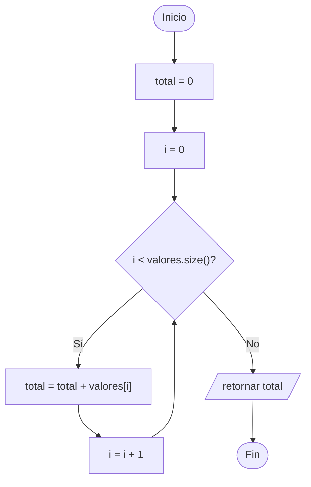

# B3 – Suma con sobrecarga de parámetros (sesión 12B)

> Ejercicio 1 de la sesión 12B: *construya una función con sobrecarga de parámetros que realice la suma de números enteros y de números reales.*

Es **el ejercicio** de la sesión 12B. El ejemplo que lo precede está en [B1_SobrecargaEjemplo](../B1_SobrecargaEjemplo).

## Las seis versiones

Un solo nombre, `suma`, y seis firmas distintas:

| Firma | Qué suma |
|---|---|
| `entero suma(entero, entero)` | dos enteros |
| `real suma(real, real)` | dos reales |
| `entero suma(entero, entero, entero)` | tres enteros |
| `real suma(real, real, real)` | tres reales |
| `entero suma(const vector<entero>&)` | todos los de un vector de enteros |
| `real suma(const vector<real>&)` | todos los de un vector de reales |

El mínimo que pide el enunciado son las dos primeras; las otras cuatro muestran que la sobrecarga también distingue por **cantidad** de parámetros, no solo por tipo.

## Cómo elige el compilador

El compilador arma una lista de candidatas y se queda con la **coincidencia exacta**:

```cpp
suma(7, 5);          // dos int      -> version entera
suma(7.5f, 5.25f);   // dos float    -> version real
suma(1, 2, 3);       // tres int     -> version entera de 3
```

Todo esto ocurre **en tiempo de compilación**: el ejecutable ya trae decidida la llamada. Es lo contrario de lo que pasa con `virtual` en A1–A5, donde la decisión se toma en ejecución.

| | Sobrecarga (B3) | Funciones virtuales (A1–A5) |
|---|---|---|
| Cuándo se decide | compilación | ejecución |
| Según qué | tipos de los argumentos | tipo real del objeto |
| Necesita herencia | no | sí |
| Rama del cuadro | ad-hoc → overloading | universal → inclusion |

## Para pensar: la llamada ambigua

Esta línea está comentada en el `main` a propósito:

```cpp
// suma(7, 5.5f);
```

No compila. No hay ninguna versión `suma(entero, real)`, y para usar cualquiera de las dos existentes habría que convertir un argumento:

- para la entera: `5.5f` → `entero` (se pierde el decimal),
- para la real: `7` → `real`.

Ninguna conversión es mejor que la otra, así que el compilador se declara incapaz:

```
error: call of overloaded 'suma(int, float)' is ambiguous
```

Se arregla de tres formas: agregando la versión mixta, convirtiendo explícitamente (`suma(static_cast<real>(7), 5.5f)`), o usando un `template`.

## Preguntas de la sesión

| Pregunta | Respuesta |
|---|---|
| ¿Se pueden distinguir dos funciones solo por el tipo de retorno? | No. Solo por número y tipo de parámetros |
| ¿Cuándo se decide qué versión se llama? | En compilación, mirando los argumentos |
| ¿Por qué el vector va por referencia constante? | Para no copiar todo el vector en cada llamada |
| ¿Qué pasa con `suma(7, 5.5f)`? | Es ambigua y no compila |
| ¿Se podría resolver todo con una sola función? | Sí, con un `template`: ese es el polimorfismo **paramétrico** |
| ¿Y con parámetros por defecto en vez de tres versiones? | Sí para los casos de 2 y 3 argumentos, pero no mezcla tipos |

## Diagrama de flujo – `suma(vector<entero>)`



## Ejecución

```
--- Dos argumentos ---
suma(7, 5)          = 12
suma(7.5f, 5.25f)   = 12.75

--- Un vector completo ---
suma(vector de enteros) = 108
suma(vector de reales)  = 7.5

Ingrese dos numeros enteros: 12 30
Suma entera: 42
Ingrese dos numeros reales: 2.5 4.25
Suma real: 6.75
```

## Tareas

- [ ] **1. `tipos.h`.** Los `using` de `entero`, `real` y `caracter`.
- [ ] **2. `operaciones.h`.** Declara `suma` para dos enteros y para dos reales. *Pista: es el mínimo que pide el enunciado.*
- [ ] **3. `operaciones.cpp`.** Implementa las dos.
- [ ] **4. Comprueba la elección.** Pon un `cout` distinto dentro de cada versión y mira cuál entra con `suma(7, 5)` y cuál con `suma(7.5f, 5.25f)`.
- [ ] **5. Versiones de tres parámetros.** Agrega `suma` de tres enteros y de tres reales.
- [ ] **6. Versiones con vector.** Agrega `suma(const vector<entero>&)` y `suma(const vector<real>&)`.
- [ ] **7. `main`.** Prueba las seis versiones con valores fijos.
- [ ] **8. Entrada del usuario.** Pide dos enteros y dos reales por teclado y suma cada par.
- [ ] **9. La ambigüedad.** Descomenta `suma(7, 5.5f)`, lee el error del compilador y explícalo.
- [ ] **10. Para pensar.** Reescribe todo con una sola plantilla `template<typename T> T suma(T a, T b)`. ¿Qué se gana y qué se pierde?
