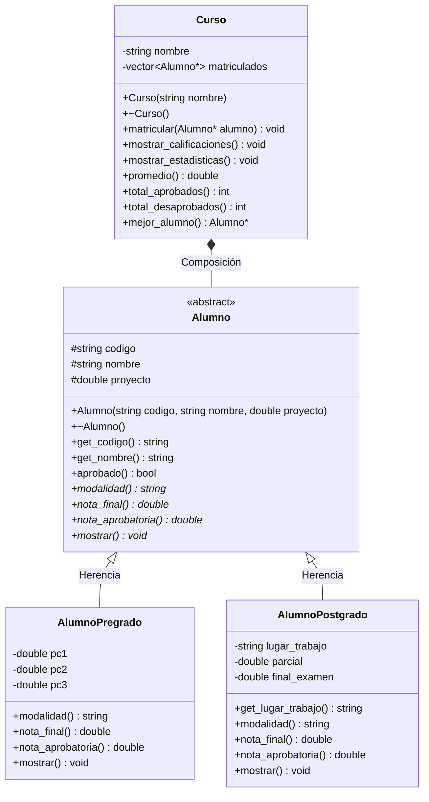
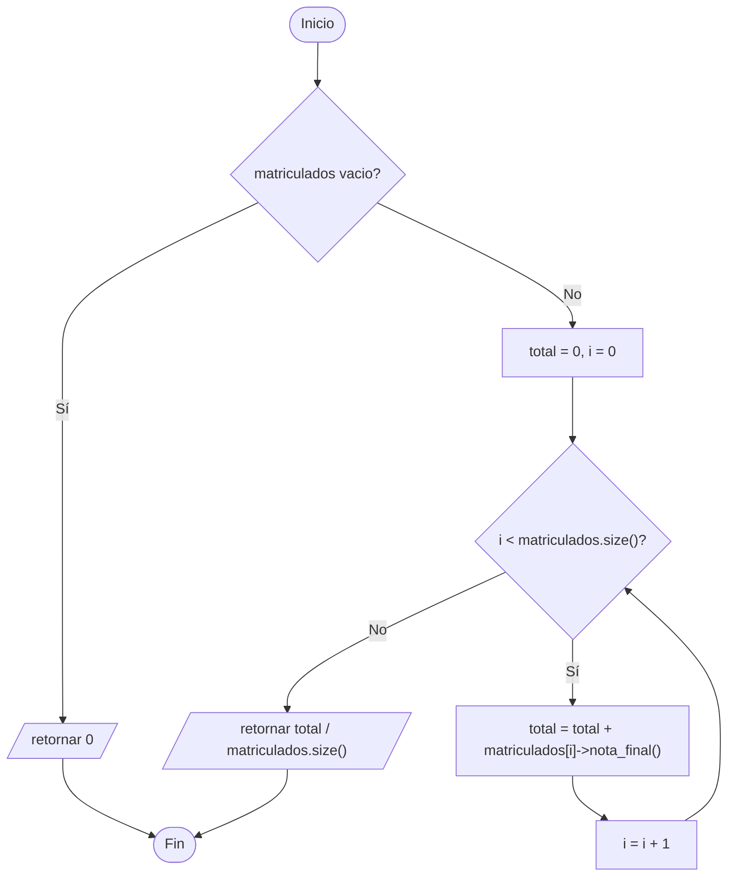

# B4 – Ejercicio integrador: notas de Pre-Grado y Post-Grado (sesión 12B)

> Ejercicio integrador de la sesión 12B: *el curso de C++ acepta alumnos matriculados de la modalidad Pre-Grado y Post-Grado.*
>
> **Pre-Grado:** se registra Código, Nombre, PC1, PC2, PC3 y Proyecto. `NF = 0.2*PC1 + 0.2*PC2 + 0.2*PC3 + 0.4*Proyecto`. Se aprueba con **13.00**.
>
> **Post-Grado:** se registra Código, Nombre, Lugar de Trabajo, Parcial, Final y Proyecto. `NF = 0.3*Parcial + 0.3*Final + 0.4*Proyecto`. Se aprueba con **11.00**.
>
> *Realizar un programa que permita administrar las calificaciones de un grupo de alumnos matriculados en el curso de C++ y calcular las estadísticas del curso.*

Cierra la unidad: junta la clase abstracta de A4, el polimorfismo de A1–A3 y la administración de una colección como en A2.

## Diagrama de clase



## Qué es común y qué es propio

| | Pre-Grado | Post-Grado |
|---|---|---|
| Comunes | código, nombre, proyecto | código, nombre, proyecto |
| Propios | PC1, PC2, PC3 | lugar de trabajo, Parcial, Final |
| Fórmula | `0.2*PC1 + 0.2*PC2 + 0.2*PC3 + 0.4*Proy` | `0.3*Parcial + 0.3*Final + 0.4*Proy` |
| Mínimo aprobatorio | 13.00 | 11.00 |

Lo común sube a `Alumno`; lo propio queda en cada subclase. Esa es toda la decisión de diseño del ejercicio.

## El detalle fino: el mínimo también es polimórfico

El error típico es escribir `aprobado()` así:

```cpp
bool Alumno::aprobado() const {
    return nota_final() >= 13.0;     // MAL: 13 solo vale para Pre-Grado
}
```

Como los dos minimos son distintos, el mínimo también tiene que preguntarse a la subclase:

```cpp
virtual double nota_aprobatoria() const = 0;   // 13.00 en Pre, 11.00 en Post

bool Alumno::aprobado() const {
    return nota_final() >= nota_aprobatoria();  // dos llamadas virtuales
}
```

Así `aprobado()` se escribe **una sola vez** en la superclase y sirve para las dos modalidades. Si mañana se abre una tercera modalidad, `aprobado()` no se toca.

En la salida de prueba se ve el efecto: Luis Torres saca 12.20 y desaprueba (Pre-Grado, mínimo 13), mientras que Jorge León saca 13.50 y aprueba con holgura (Post-Grado, mínimo 11).

## Las estadísticas

`Curso` guarda `vector<Alumno*>` y calcula todo con un bucle y `nota_final()`:

| Método | Qué hace |
|---|---|
| `promedio()` | suma las notas finales y divide entre el total |
| `total_aprobados()` | cuenta los que cumplen `aprobado()` |
| `total_desaprobados()` | el resto |
| `mejor_alumno()` | recorre comparando `nota_final()` y devuelve el puntero |

Ninguno pregunta de qué modalidad es cada alumno. **No hay un solo `if` por tipo en todo `Curso.cpp`.**

La relación `Curso`→`Alumno` es **composición**, como en A4: el curso libera a sus alumnos en el destructor y el `main` no hace ningún `delete`.

## Preguntas de la sesión

| Pregunta | Respuesta |
|---|---|
| ¿Por qué `Alumno` es abstracta? | No existe un alumno sin modalidad: no hay fórmula que aplicarle |
| ¿Por qué `aprobado()` **no** es virtual pura? | Porque la comparación es la misma; lo que cambia son los dos valores que compara |
| ¿Por qué `nota_aprobatoria()` es un método y no una constante? | Para que cada subclase devuelva el suyo y `aprobado()` funcione para todos |
| ¿Dónde está el `delete`? | En `~Curso()`: el curso es dueño de sus alumnos |
| ¿Cómo agrego una modalidad "Continua"? | Una subclase más, con su fórmula y su mínimo. `Curso` no se toca |
| ¿Por qué el atributo se llama `final_examen` y no `final`? | `final` es palabra reservada de C++ para cerrar la herencia |

## Diagrama de flujo – `promedio()`



## Ejecución

```
=== Curso: Programacion en C++ ===
MODALIDAD   CODIGO  NOMBRE                  EV1    EV2    EV3  PROYECTO       NF     CONDICION
----------------------------------------------------------------------------------------------
Pre-Grado   P001    Ana Quispe            15.00  14.00  16.00     18.00    16.20      APROBADO
Pre-Grado   P002    Luis Torres           10.00  12.00  11.00     14.00    12.20   DESAPROBADO
Pre-Grado   P003    Rosa Diaz             18.00  17.00  19.00     20.00    18.80      APROBADO
Post-Grado  G001    Jorge Leon            12.00  13.00      -     15.00    13.50      APROBADO
            trabaja en: Telefonica
...
=== Estadisticas del curso ===
Matriculados:  6
Promedio:      14.48
Aprobados:     4
Desaprobados:  2
Mejor alumno:  Rosa Diaz (Pre-Grado) con 18.80
```

## Tareas

- [ ] **1. Clase `Alumno`.** Atributos `protected` `codigo`, `nombre` y `proyecto`, constructores y destructor **virtual**.
- [ ] **2. Las cuatro funciones virtuales puras.** `modalidad()`, `nota_final()`, `nota_aprobatoria()` y `mostrar()`.
- [ ] **3. `aprobado()`.** **No** es virtual pura: compara `nota_final()` con `nota_aprobatoria()`.
- [ ] **4. `AlumnoPregrado`.** Agrega `pc1`, `pc2`, `pc3`. Implementa la fórmula y devuelve 13.00 como mínimo.
- [ ] **5. `AlumnoPostgrado`.** Agrega `lugar_trabajo`, `parcial` y `final_examen`. Fórmula propia y mínimo 11.00.
- [ ] **6. `mostrar()` en cada subclase.** Una fila por alumno. *Pista: `<iomanip>` con `setw` y `setprecision(2)`.*
- [ ] **7. Clase `Curso`.** Atributos privados `nombre` y `vector<Alumno*> matriculados`, con `matricular()`.
- [ ] **8. `mostrar_calificaciones()`.** Cabecera, un bucle por los alumnos y cierre. Sin `if` por modalidad.
- [ ] **9. Estadísticas.** `promedio()`, `total_aprobados()`, `total_desaprobados()` y `mejor_alumno()`.
- [ ] **10. Destructor de `Curso`.** Libera a los alumnos: la relación es composición.
- [ ] **11. `main`.** Matricula al menos tres alumnos de cada modalidad y muestra tabla y estadísticas.
- [ ] **12. Comprobación.** Pon a un alumno de Post-Grado con 12.00 y a uno de Pre-Grado con 12.00: uno aprueba y el otro no. Explica por qué.
