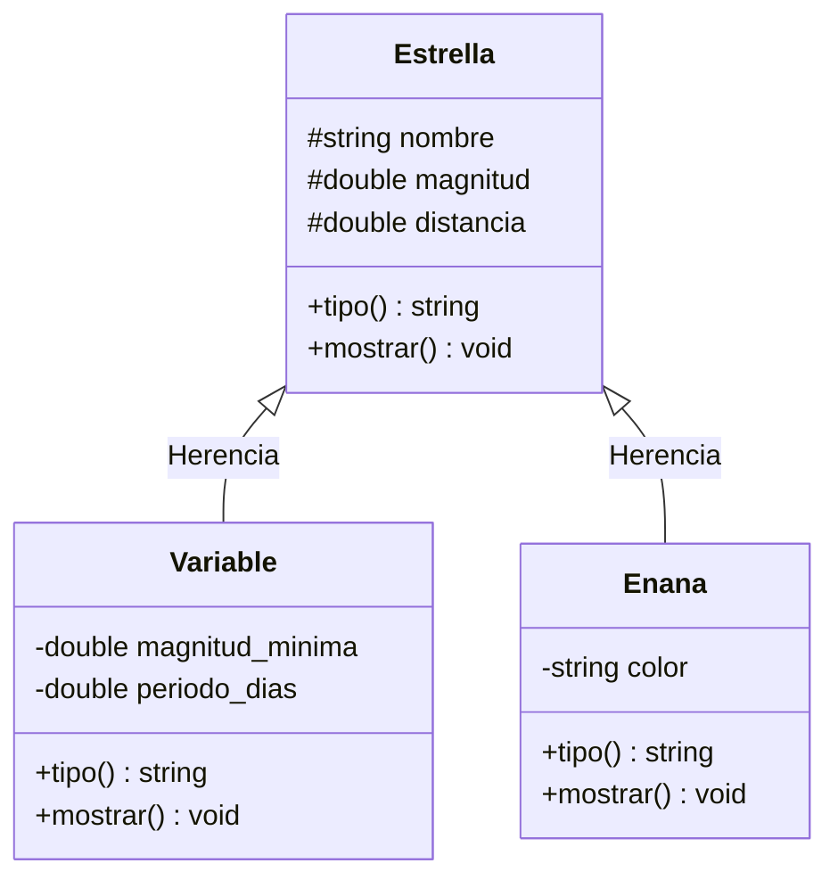
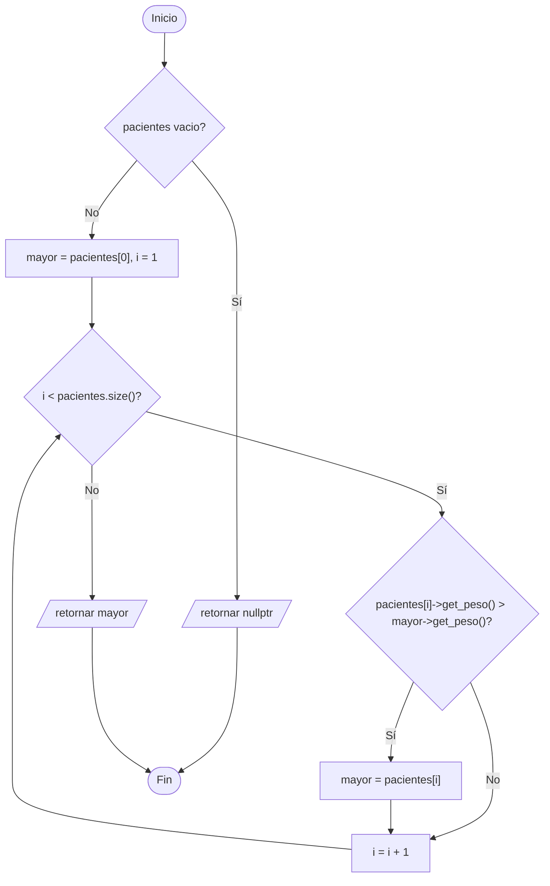
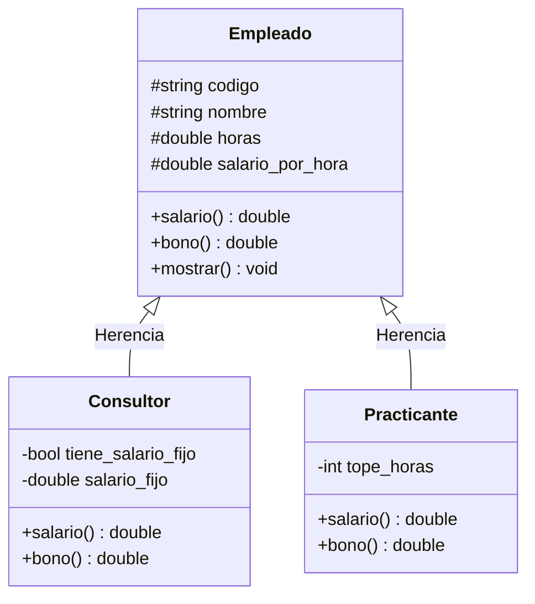
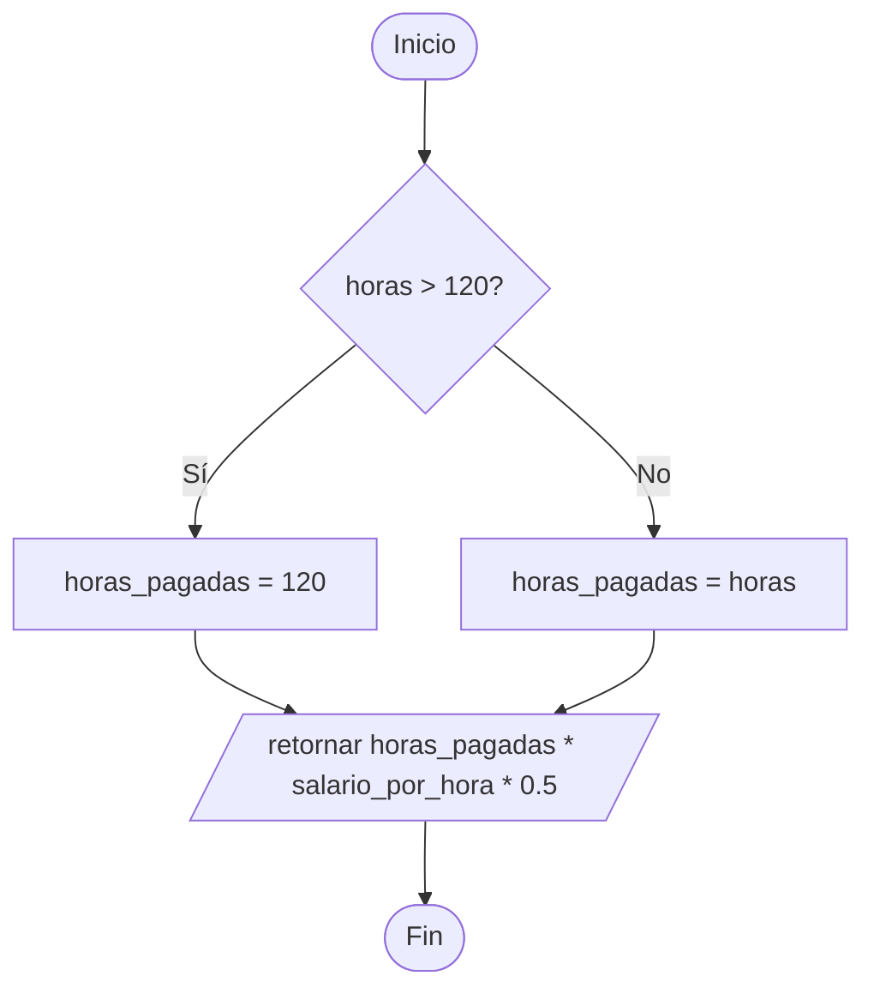
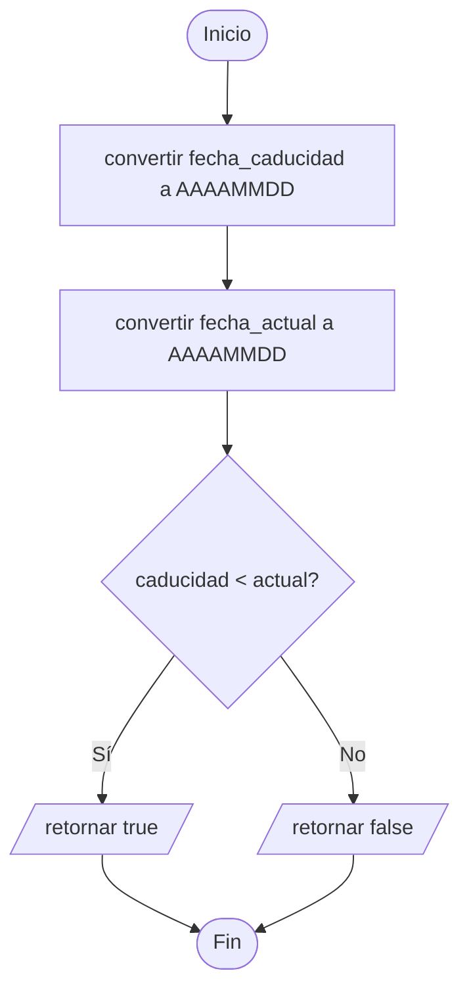
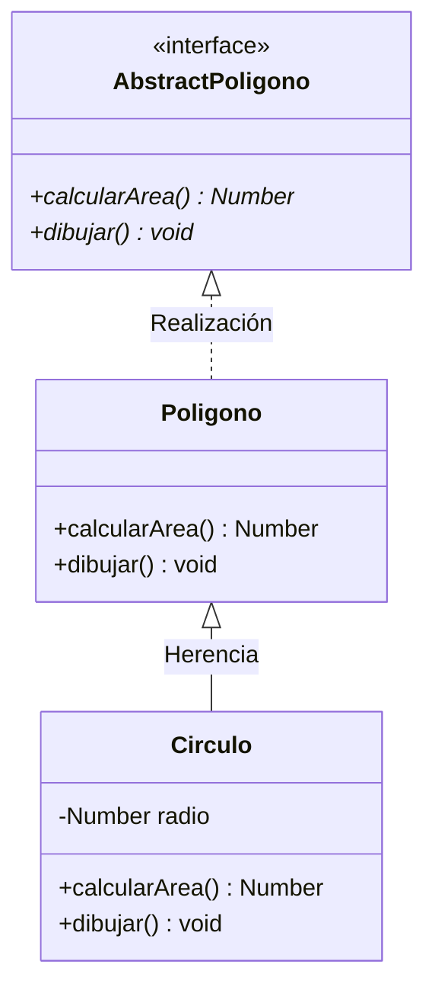
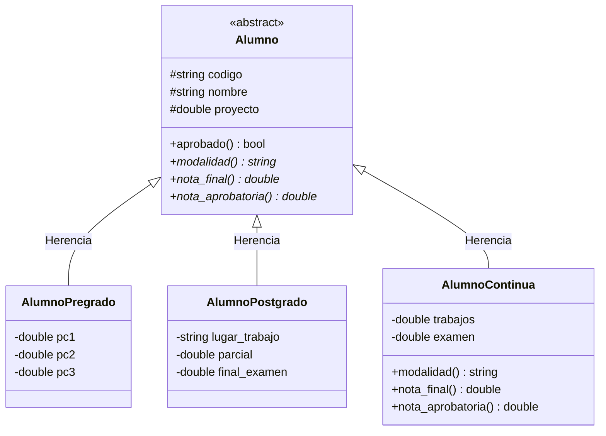
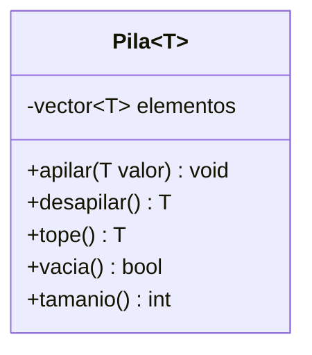
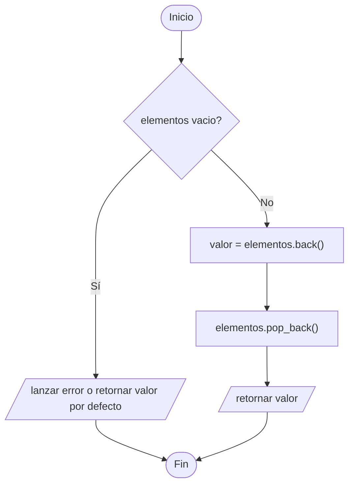

# Ejercicios propuestos – Semana 13 (Polimorfismo)

Ejercicios adicionales para los alumnos que terminen antes. Solo usan lo visto en la Semana 13: **funciones virtuales, clases abstractas, sobrecarga de funciones y operadores, casting y templates**.

| # | Ejercicio | Tipo | Tiempo aprox. |
|---|-----------|------|---------------|
| 1 | Estrellas → agregar `Variable` y `Enana` sin tocar la función genérica | Extensión de A1 | 15 min |
| 2 | Veterinaria → la mascota más pesada y el conteo por especie | Extensión de A2 | 15–20 min |
| 3 | Planilla → `Practicante` y el bono por antigüedad | Extensión de A3 | 20 min |
| 4 | Documentos → documentos vencidos a una fecha | Extensión de A4 | 20 min |
| 5 | Figuras → `operator<<` y comparación por área | Extensión de A5 | 20–25 min |
| 6 | Alumnos → modalidad Continua y el reporte por modalidad | Extensión de B4 | 20–25 min |
| 7 | `suma` con templates | Reto (paramétrico) | 15 min |
| 8 | Una pila genérica con `template` | Reto (paramétrico) | 25–30 min |

---

## 1. Estrellas → agregar `Variable` y `Enana`

**Enunciado.** Con las clases de A1, agregue dos subclases más de `Estrella`: `Variable` (con los atributos `magnitud_minima` y `periodo_dias`) y `Enana` (con el atributo `color`, por ejemplo "blanca" o "roja").

La regla del ejercicio: **solo se puede agregar una línea por estrella en el `main`** (el `push_back`). La función `imprimir_estrellas()` no se puede tocar.

**Conceptos:** extender una jerarquía sin modificar el código que la usa, `override`, por qué la función genérica no necesita ningún `if`.

**Diagrama de clase**



---

## 2. Veterinaria → la más pesada y el conteo por especie

**Enunciado.** Agregue a `Veterinaria` tres métodos:

- `Mascota* mas_pesada() const` — devuelve el puntero a la mascota de mayor peso, o `nullptr` si no hay ninguna.
- `int contar(const std::string& especie) const` — cuenta cuántos pacientes son de esa especie, usando el método virtual `especie()`.
- `double peso_promedio() const`.

Para `contar()` **no se puede usar `dynamic_cast`**: hay que apoyarse en lo que ya devuelve `especie()`.

**Conceptos:** recorrer una colección polimórfica acumulando, devolver puntero para poder devolver `nullptr`, resolver con un método virtual lo que la tentación pide resolver con un cast.

**Diagrama de flujo – `mas_pesada()`**



---

## 3. Planilla → `Practicante` y bono por antigüedad

**Enunciado.** Con las clases de A3, agregue la clase `Practicante`, que cobra el 50 % de la tarifa por hora y tiene un tope de 120 horas al mes: si trabajó más, solo se le pagan 120.

Agregue además a `Empleado` el método `virtual double bono() const`, que devuelve 0, y sobrescríbalo en `Consultor` (10 % del salario) y en `Practicante` (siempre 0). El total de planilla del `main` debe sumar `salario() + bono()`.

**Conceptos:** un método virtual con comportamiento por defecto útil en la superclase, tres implementaciones distintas de la misma fórmula, reutilizar `Empleado::salario()` desde la subclase.

**Diagrama de clase**



**Diagrama de flujo – `Practicante::salario()`**



---

## 4. Documentos → vencidos a una fecha

**Enunciado.** Con las clases de A4, agregue a `Documento` el método `bool esta_vencido(const std::string& fecha_actual) const`, que compara la fecha de caducidad con la fecha dada.

Agregue a `Persona` el método `void mostrar_vencidos(const std::string& fecha_actual) const`, que muestra solo los documentos vencidos, y `int total_vencidos(...) const`.

*Pista para la comparación:* con el formato `DD/MM/AAAA` no se puede comparar como texto. Conviértalo a `AAAAMMDD` (un entero) antes de comparar, o compare año, mes y día por separado.

**Conceptos:** un método no virtual en la superclase que usa datos comunes, por qué el orden de un `string` de fecha no sirve para comparar, filtrar una colección polimórfica.

**Diagrama de flujo – `esta_vencido()`**



---

## 5. Figuras → `operator<<` y comparación por área

**Enunciado.** Con las clases de A5:

1. Agregue la clase `Circulo` (atributo `radio`, área `PI * radio * radio`).
2. Sobrecargue `operator<<` como **función libre** para imprimir cualquier figura:

```cpp
std::ostream& operator<<(std::ostream& os, Poligono& p);
```

3. Sobrecargue `operator<` para comparar dos figuras por su área, y ordene el vector con `std::sort`.

Al terminar, el `main` debe poder escribir `cout << *poligonos[i] << endl;` sin llamar a `dibujar()`.

**Conceptos:** sobrecarga de operadores como función libre y por qué no puede ser método, combinar sobrecarga (ad-hoc) con `virtual` (inclusión) en el mismo programa, usar un operador propio desde la STL.

**Diagrama de clase**



---

## 6. Alumnos → modalidad Continua y reporte por modalidad

**Enunciado.** Con las clases de B4, agregue la modalidad `AlumnoContinua`: se registra Código, Nombre, Trabajos (promedio), Examen y Proyecto, con `NF = 0.3*Trabajos + 0.3*Examen + 0.4*Proyecto` y se aprueba con **12.00**.

La regla del ejercicio: **no se puede tocar `Curso.cpp`** para que las estadísticas sigan funcionando.

Agregue después a `Curso` el método `void mostrar_estadisticas(const std::string& modalidad) const`, que calcula promedio y aprobados **solo** de una modalidad. *Pista: compare con el método virtual `modalidad()`, sin `dynamic_cast`.*

**Conceptos:** cerrar el diseño a modificaciones y abrirlo a extensiones, un método virtual que devuelve una etiqueta en vez de preguntar el tipo con un cast, sobrecarga de `mostrar_estadisticas()` (sin parámetro y con parámetro).

**Diagrama de clase**



---

## 7. `suma` con templates

**Enunciado.** Reescriba las seis funciones de B3 usando **una sola plantilla**:

```cpp
template<typename T>
T suma(T a, T b) {
    return a + b;
}
```

Agregue la versión de tres parámetros y la versión que recibe un `std::vector<T>`. Después pruébela con `int`, `float`, `double` y `std::string` (concatenar textos), y responda:

1. ¿Cuántas funciones generó realmente el compilador?
2. ¿Qué pasa si la llama con `suma(7, 5.5f)`? ¿El error es mejor o peor que el de B3?
3. ¿Qué pasa si la llama con un tipo que no tiene `operator+`?

**Conceptos:** polimorfismo **paramétrico** (la rama *universal → parametric* del cuadro), diferencia entre escribir N funciones y escribir una plantilla, calidad de los mensajes de error.

---

## 8. Una pila genérica con `template`

**Enunciado.** Implemente una clase `Pila<T>` con un `std::vector<T>` adentro y los métodos `apilar(T)`, `desapilar()`, `tope()`, `vacia()` y `tamanio()`.

Pruébela con `Pila<int>`, `Pila<std::string>` y `Pila<Estrella*>` (reutilizando las clases de A1). En este último caso, al desapilar, llame a `mostrar()` y compruebe que el polimorfismo sigue funcionando dentro de la plantilla.

Toda la clase va en el `.h`: **las plantillas no se separan en `.h` y `.cpp`** como las clases normales. Esa es parte de la lección.

**Conceptos:** una estructura de datos genérica, por qué una plantilla se define completa en el header, combinar polimorfismo paramétrico (la pila) con polimorfismo de inclusión (lo que guarda adentro).

**Diagrama de clase**



**Diagrama de flujo – `desapilar()`**


