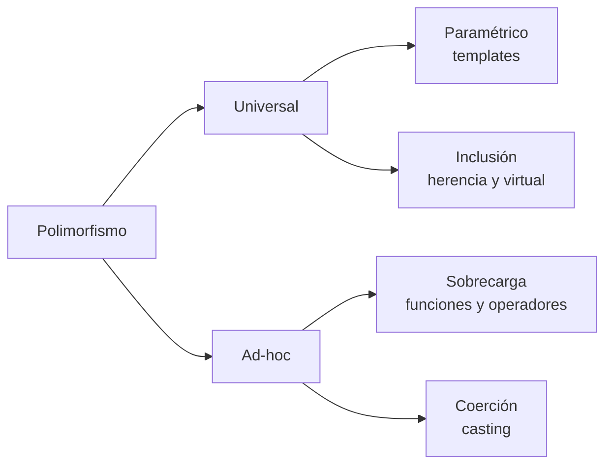

# PO_UTEC – Semana 13 (Polimorfismo)

Laboratorio de **Programación II (CS6003)**, Unidad 7: *Polimorfismo*. Resumen de la teoría de las sesiones 12A y 12B (**clasificación del polimorfismo, funciones virtuales, sobrecarga de funciones y operadores, y casting**) y de dónde se usa cada concepto en los ejercicios.

## Ejercicios del laboratorio

| Carpeta | Ejercicio | Concepto que usa |
|---------|-----------|------------------|
| `A1_Estrellas` | Estrellas simples y binarias con una función genérica que las imprime | polimorfismo de inclusión: `virtual` + `vector<Estrella*>` |
| `A2_MascotaVeterinaria` | Perros y gatos administrados por una veterinaria | inclusión + agregación; impresión desde un método de clase |
| `A3_EmpleadoConsultor` | Planilla con empleados por hora y consultores con salario fijo | `override` que **reutiliza** la versión de la superclase |
| `A4_Documentos` | DNI, CEX, Pasaporte y Brevete dentro de una `Persona` | clase abstracta + composición |
| `A5_Figuras` | Jerarquía de polígonos con interfaz, clase intermedia y tres figuras | interfaz (`AbstractPoligono`) + clase intermedia |
| `B1_SobrecargaEjemplo` | `swap` sobrecargado y `operator+=` de `Alumno` | sobrecarga de funciones y de operadores |
| `B2_CastingEjemplo` | Conversiones implícitas y los cuatro operadores de casting | polimorfismo de coerción |
| `B3_SumaSobrecargada` | Suma de enteros y de reales con un solo nombre de función | sobrecarga de parámetros |
| `B4_AlumnosNotas` | Notas de Pre-Grado y Post-Grado con estadísticas del curso | integrador: abstracta + inclusión + composición |

Ejercicios adicionales: [EJERCICIOS_PROPUESTOS.md](EJERCICIOS_PROPUESTOS.md)

---

## 1. ¿Qué es el polimorfismo?

*Polimorfismo* significa "muchas formas": **un mismo nombre produce comportamientos distintos según el contexto**.

Ya lo vienen usando sin darse cuenta desde la primera semana:

```cpp
cout << 5;        // imprime un entero
cout << 5.5;      // imprime un real
cout << "hola";   // imprime una cadena
```

`<<` es uno solo, y hace tres cosas distintas según lo que reciba. Eso es polimorfismo.

La semana pasada se vio el caso con herencia: un `Alimento*` que apunta a una `Verdura` y ejecuta el método de la verdura. Esta semana se le pone nombre a eso y se ven **las otras tres formas** que tiene C++.

---

## 2. La clasificación de Cardelli y Wegner

El cuadro clásico de la clasificación:



> Luca Cardelli and Peter Wegner. 1985. *On understanding types, data abstraction, and polymorphism.* ACM Comput. Surv. 17, 4, 471–523.

La diferencia entre las dos ramas:

| | Universal | Ad-hoc |
|---|---|---|
| Cuántos tipos acepta | infinitos, con el mismo código | unos pocos, escritos uno por uno |
| El código se escribe | una vez | una vez **por cada caso** |
| Formas | paramétrico (templates), inclusión (herencia) | sobrecarga, coerción |

| Forma | Cuándo se decide | Palabra clave | Dónde se practica |
|---|---|---|---|
| **Paramétrico** | compilación | `template` | teoría; propuestos 7 y 8 |
| **Inclusión** | **ejecución** | `virtual` | A1 a A5, B4 |
| **Sobrecarga** | compilación | mismo nombre, otra firma | B1, B3, A3 |
| **Coerción** | compilación | `static_cast` y familia | B2 |

De las cuatro, **solo la inclusión decide en tiempo de ejecución**. Las otras tres ya vienen resueltas en el ejecutable.

---

## 3. Polimorfismo de inclusión (el de `virtual`)

Es el que más peso tiene en el laboratorio. La receta son cuatro piezas:

```cpp
class Estrella {
public:
    virtual ~Estrella();                  // 1. destructor virtual
    virtual void mostrar() const;         // 2. metodo virtual en la superclase
};

class Simple : public Estrella {
public:
    void mostrar() const override;        // 3. override en la subclase
};

vector<Estrella*> cielo;                  // 4. punteros al tipo base
cielo.push_back(new Simple(...));
cielo[0]->mostrar();                      // corre Simple::mostrar()
```

**Las cuatro son obligatorias.** Si falta cualquiera, el polimorfismo no ocurre:

| Si falta | Qué pasa |
|---|---|
| `virtual` | siempre corre la versión de la superclase |
| `override` | un error de firma crea una función nueva y nadie avisa |
| el destructor virtual | `delete` no libera la parte de la subclase |
| los punteros (copia por valor) | el objeto se **corta** y pierde su parte derivada |

### El corte de objetos

```cpp
Estrella copia = *unaSimple;   // copia solo la parte Estrella
copia.mostrar();               // version de Estrella: ya no es una Simple
```

Por eso toda la jerarquía se maneja con `vector<Tipo*>` y no con `vector<Tipo>`. Y si la superclase es abstracta, `vector<Tipo>` ni siquiera compila.

**Se usa en:** A1, A2, A3, A4, A5 y B4.

---

## 4. Enlace estático y enlace dinámico

Es la frase que resume la unidad: **el tipo del puntero decide qué se puede llamar; el tipo del objeto decide qué se ejecuta.**

```cpp
Estrella* p = new Simple("Vega", 0.03, 25.0, "A0");

p->mostrar();           // OK: mostrar() existe en Estrella -> corre la de Simple
p->claseEspectral();    // ERROR: Estrella no tiene ese metodo
```

| | Enlace estático | Enlace dinámico |
|---|---|---|
| Cuándo se resuelve | compilación | ejecución |
| Con qué información | el tipo declarado del puntero | el tipo real del objeto |
| Qué lo activa | lo normal | `virtual` |
| Costo | ninguno | un salto por la tabla de funciones |

El costo del enlace dinámico: cada objeto de una clase con funciones virtuales carga un puntero escondido a la tabla de su clase (8 bytes en 64 bits), y cada llamada pasa por esa tabla. Para el curso, irrelevante.

---

## 5. Sobrecarga de funciones

Mismo nombre, **distinta lista de parámetros**:

```cpp
void swap(entero&, entero&);
void swap(real&, real&);
```

El compilador elige la versión mirando **número y tipo de argumentos**. Reglas:

- **El tipo de retorno no cuenta**: `int f(int)` y `float f(int)` no pueden convivir.
- Si ningún candidato es coincidencia exacta y hay más de uno posible, la llamada es **ambigua** y no compila (`suma(7, 5.5f)` en B3).
- Los constructores también se sobrecargan: es lo que hace `Consultor` en A3 para distinguir "con salario fijo" de "sin salario fijo".

**Se usa en:** B1, B3 y los dos constructores de A3.

---

## 6. Sobrecarga de operadores

Es la sobrecarga aplicada a los símbolos del lenguaje:

```cpp
ReturnType classname::operator OperatorSymbol(lista de argumentos)
```

```cpp
Alumno& Alumno::operator+=(Alumno alu) {
    this->edad += alu.getEdad();
    return *this;
}
```

- Devolver **referencia** (`Alumno&`) permite encadenar: `a1 += a2 += a3`.
- `return *this;` devuelve el objeto mismo, no una copia.
- Se puede sobrecargar casi todo: `+ - * / == < << >> [] () =` …
- **No** se pueden sobrecargar `.`, `::`, `?:` ni `sizeof`.
- Regla de sentido común: que el operador haga lo que cualquiera esperaría. Un `+` que resta es legal y es una trampa.

**Se usa en:** B1.

---

## 7. Polimorfismo de coerción (casting)

Convertir un valor de un tipo a otro. Dos formas:

```cpp
entero a = 9.99;              // implicita: la hace el compilador (trunca a 9)
entero x = (entero) 3.1415;   // explicita al estilo C
entero y = static_cast<entero>(3.1415);   // explicita con nombre
```

La escalera de promoción:

```
bool -> char -> short int -> int -> unsigned int -> long -> unsigned -> long long -> float -> double -> long double
```

Hacia la derecha no se pierde nada; hacia la izquierda se trunca.

| Operador | Para qué |
|---|---|
| `static_cast` | conversiones normales entre tipos relacionados |
| `const_cast` | quitar o poner `const` |
| `reinterpret_cast` | leer los mismos bytes como otro tipo |
| `dynamic_cast` | preguntar en ejecución de qué clase es un objeto (necesita una función virtual) |

Se prefieren a `(tipo)valor` porque **se ven**: son buscables en el código y el compilador verifica más.

**Se usa en:** B2.

---

## 8. Polimorfismo paramétrico (templates)

La cuarta forma. Se escribe el algoritmo **una sola vez** y sirve para cualquier tipo:

```cpp
template<typename T>
T suma(T a, T b) {
    return a + b;
}

suma(3, 4);        // T = int
suma(3.5, 4.5);    // T = double
suma(string("a"), string("b"));   // T = string
```

Compare con B3, donde la misma idea se resuelve escribiendo una función por tipo. Las dos son polimorfismo; la diferencia es cuánto código hay que repetir.

| | Sobrecarga (B3) | Template |
|---|---|---|
| Código escrito | uno por cada tipo | uno solo |
| Tipos que soporta | los que escribí | cualquiera que soporte las operaciones usadas |
| Dónde falla el error | en la llamada | dentro de la plantilla, con mensajes largos |

Se ve en la teoría de la sesión y se practica en los [ejercicios propuestos](EJERCICIOS_PROPUESTOS.md).

---

## 9. Errores frecuentes

- Olvidar `virtual` y creer que el polimorfismo "no funciona": funciona, solo que nunca se activó.
- Esperar polimorfismo en una **copia por valor**: el objeto se corta y pierde su parte derivada.
- Guardar objetos en `vector<Base>` en vez de `vector<Base*>`: corte silencioso si la clase es concreta, error de compilación si es abstracta.
- Olvidar el **destructor virtual**: fuga de memoria que no da ningún síntoma visible.
- Cambiar la lista de parámetros al sobrescribir: ya no es `override`, es una función nueva que **oculta** a la heredada. Marcar siempre `override`.
- Intentar sobrecargar dos funciones que solo difieren en el tipo de retorno.
- Escribir una llamada ambigua (`suma(7, 5.5f)`) y no entender el error del compilador.
- Poner en la superclase una constante que cambia por subclase (el 13 de `aprobado()` en B4): si varía, tiene que ser un método virtual.
- Usar `dynamic_cast` para preguntar el tipo donde debió haber una función virtual.
- Confundir `virtual` con `override`: `virtual` abre la puerta en la superclase; `override` confirma que la subclase la usó bien.

---

## 10. Miscelánea: preguntas frecuentes

| Pregunta | Respuesta corta |
|---|---|
| ¿`override` es obligatorio? | No, pero sin él los errores de firma pasan callados |
| ¿Puedo sobrecargar `operator=`? | Sí, y hay que hacerlo cuando la clase maneja memoria |
| ¿Por qué `cout << x` funciona con todo? | Porque `operator<<` está sobrecargado decenas de veces en la STL |
| ¿Qué pasa si llamo a un virtual desde el constructor? | Corre la versión de la clase que se está construyendo, no la del hijo |
| ¿Se puede tener un `vector` con objetos de tipos distintos? | Solo con punteros a una base común |
| ¿`virtual` cuesta rendimiento? | Sí, un salto por tabla y 8 bytes por objeto. Irrelevante en el curso |
| ¿Template o sobrecarga? | Template si el algoritmo es el mismo; sobrecarga si cada tipo hace algo distinto |
| ¿Puedo sobrecargar una función virtual? | Sí, pero entonces solo una de las versiones es la sobrescrita |
| ¿`dynamic_cast` es caro? | Más que un `if`, y casi siempre es señal de que falta un método virtual |

### Un virtual llamado desde el constructor

```cpp
Estrella::Estrella(...) {
    mostrar();     // NO llama a la version de Simple
}
```

Mientras corre el constructor de `Estrella`, el objeto todavía no "es" una `Simple`: las partes de abajo no se han construido. Si la función fuera virtual pura, el programa se cae en ejecución.

Dato para los que vienen de Java: allá pasa lo **contrario**, se llama a la versión del hijo con los atributos del hijo aún sin inicializar. Las dos conductas son trampas, pero distintas.

### Sobrecargar `operator<<` para imprimir un objeto

Es el paso natural después de B1, y evita escribir `mostrar()`:

```cpp
std::ostream& operator<<(std::ostream& os, const Estrella& e) {
    os << e.get_nombre();
    return os;
}

cout << miEstrella << endl;
```

Va como **función libre**, no como método, porque el operando de la izquierda es el `ostream` y no la clase. Está en el propuesto 5.

## Compilación

Cada carpeta es un proyecto CMake independiente (CLion). Ejecute siempre desde el botón ▶ del target del proyecto.
